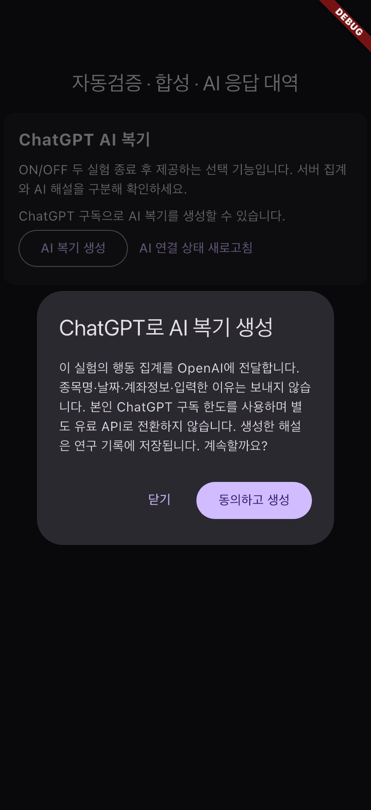
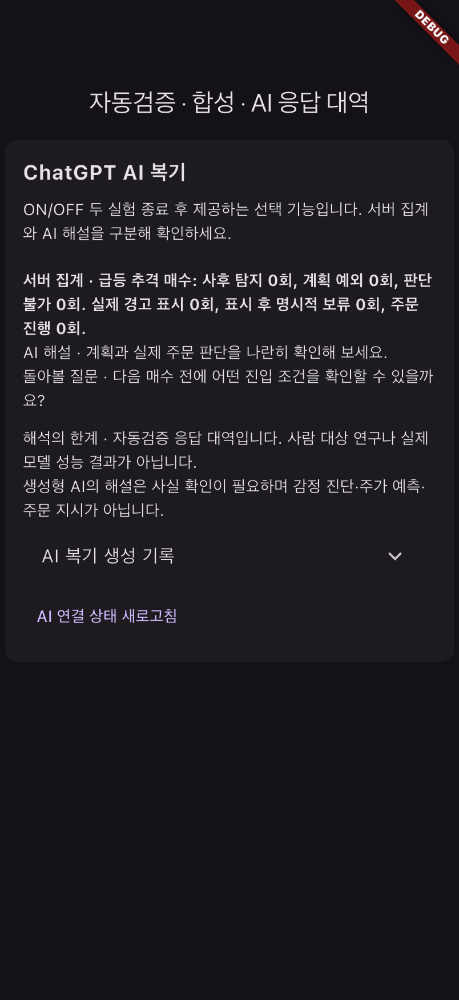

# ChatGPT Plus · 종료 후 AI 복기 구현 보고서

2026-11-02. 개인 로컬 환경의 공식 ChatGPT 구독 연결 경로를 추가했다. 본인 인증과 동의는 사용자가 브라우저에서 완료해야 하며 실제 Plus 추론 성공은 아직 확인하지 않았다.

## 앱에서 추가된 기능

- ON/OFF 실험 한 쌍을 모두 종료한 뒤 결과 화면에 **ChatGPT AI 복기** 제공.
- 동의 후 행동 집계만 외부에 전달하고, 사실별 해설·돌아볼 질문 표시.
- 기본 피드백과 AI 해설 구분, 연결 미설정/오류/한도 초과 안내, 완료 결과 재사용.
- 연구 JSON에 입력·프롬프트·모델·출력·사용량·시간 기록. 기존 실험 계산과 주문 처리 불변.
- 첫 실험 직후 생성 차단으로 두 번째 조건에 피드백이 개입하는 것을 방지. 추후 여러 쌍을 반복하는 연구에서는 복기 노출의 학습 효과를 별도로 설계해야 함.

## 서버 구현

`app/llm/chatgpt_login.py`와 `tool/connect_chatgpt.sh`에서 앱 계정 확인 → 공식 브라우저 OAuth → 계정별 모델 선택 → 보호된 로컬 저장을 제공한다. PKCE, state, nonce, JWT 서명·대상·발급자·만료, 반환 계정 일치 및 구독 권한을 검증한다. 다른 앱의 인증 자료나 유료 API 키는 사용하지 않는다.

`app/llm/chatgpt.py`는 공식 Responses API의 스트리밍 완료 이벤트만 성공으로 인정한다. `store=false`, `stream=true`와 현재 미리보기의 허용 요청 형식을 사용한다. 임의 재시도나 유료 API로의 자동 전환은 없다.

`app/services/ai_review.py`는 익명 집계 입력, 결과 형식·근거 ID 검증, DB 작업/별도 워커, 완료 캐시, 재시도·일일 한도와 연구 기록을 담당한다. 마이그레이션은 `20261102_ai_reviews`다. 기존 데이터의 사용자·주문·실험·사례 행 식별자 보존을 확인했다.

## 검증

- 서버 전체 215개 통과, 이후 연결 해제 추가 테스트 1개 통과(서로 다른 총 216개).
- Flutter 전체 49개 통과, analyze 정상, Ruff 검사/포맷 및 uv lock 확인 통과.
- iPhone 17 네이티브 통합 성공: 쌍 종료 전 차단, 동의 전 외부 요청 없음, 생성·표시·내보내기, 재조회/중복 요청 시 외부 재생성 없음.
- 통합 검증에는 **합성 사례와 OpenAI HTTP 응답 대역**을 사용했다. 실제 OpenAI 외부 호출은 0건이다. 실제 모델 품질·참가자 효과를 입증한 자료가 아니다.
- 검증 종료 후 임시 서버를 정리하고 일반 시연 서버 18081과 최신 일반 앱으로 복원했다. 실제 AI 작업은 아직 0건이다.

## 자동검증 화면

아래는 실제 iPhone 시뮬레이터 캡처이며, 화면에 합성·응답 대역임을 표시했다.

## 사용자에게 남은 설정

프로젝트 터미널에서 `./tool/connect_chatgpt.sh`를 실행하고, 본인 앱 계정 확인과 브라우저의 ChatGPT Plus 연결 동의를 완료해야 한다. 이후 앱에서 두 실험을 종료하고 AI 복기를 요청한다. 계정·미리보기 제공 조건 또는 한도로 거절되면 기본 피드백을 유지하며 자동으로 다른 결제 경로를 사용하지 않는다.

[단계별 연결·사용·해제 안내](server/docs/chatgpt-review.md)

현재는 연구용 종료 후 해설 기능이다. 주가 예측 모델 교체·실계좌 주문·일반 주문 전 LLM 피드백은 별도 후속 작업이다.
