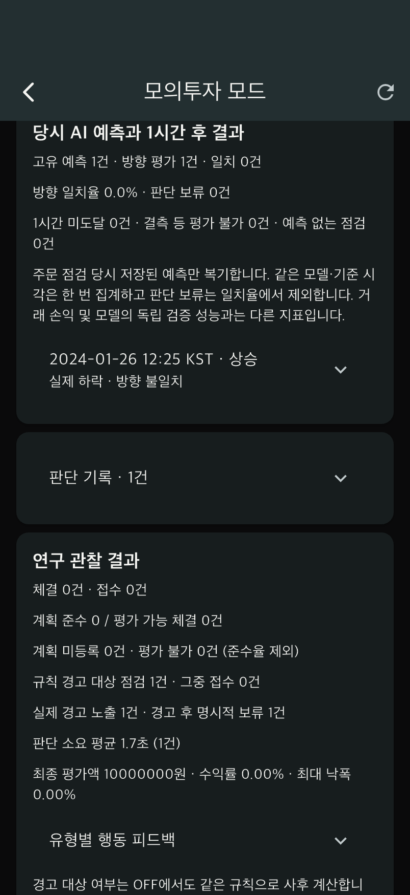
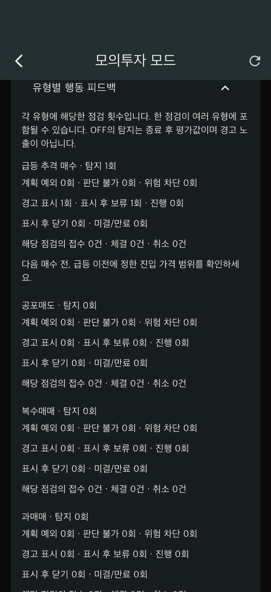

# TradePilot F-05 복기·연구 기록 보완

작성일: 2026-11-01. 기능명세 v3 10쪽의 「예측과 결과」「원칙 준수」「반복 행동」 요구를 과거 장세 실험에 연결했다. 일반 매매일지에 있던 내용을 독립 재생 계좌에도 적용한 개발 결과다.

## 1. 앱에서 추가된 동작

모의투자 → 사례 선택 → 주문 점검 → 다음 5분봉 진행 → 실험 종료 후 결과 화면에서 확인한다.

- **당시 AI 예측과 1시간 후 결과:** 주문 점검 시 저장된 방향·확률·모델 버전을 사용한다. 같은 모델·기준 시각의 반복 점검은 고유 예측 한 건으로 계산한다. 실제 1시간 수익률이 +0.5% 초과면 상승, -0.5% 미만이면 하락, 경계값 포함 나머지는 보합이다.
- **평가 분모:** 판단 보류는 방향 일치율에서 제외한다. 예측 자체가 없는 점검도 별도 집계한다. 평가 가능한 예측이 없으면 일치율은 `null`/‘평가 없음’이다.
- **조기 종료·결측:** 실험에서 실제 공개된 봉만 평가에 사용한다. 종료 시 목표 시각에 못 미치면 ‘1시간 미도달’, 12개 5분봉 중 결측이 있으면 ‘평가 불가’다. 숨겨진 미래값이나 다음 관측값으로 대체하지 않는다.
- **유형별 행동 피드백:** 급등 추격, 공포매도, 복수매매, 과매매, 계획 위반별 탐지·계획 예외·판단 불가·위험 차단, 실제 표시 후 보류/진행/닫기/미결, 연결 주문의 접수/체결/취소를 구분한다. 탐지된 유형에 맞는 다음 거래 점검 원칙을 안내한다.
- **계획 준수:** 평가 가능한 체결에만 준수율을 적용하고, 계획 미등록·평가 불가 체결 수를 따로 표시한다.

복기 정보는 완료된 실험에만 공개된다. Pilot OFF 진행 중에는 내부 행동 평가를 노출하지 않는다. 이번 예측 복기는 주문 점검 때 저장한 예측을 대상으로 하며, 단순히 차트를 열어 본 모든 시점의 예측 노출 기록은 아니다.

## 2. 연구 재현성 보완

- 새 실험 시작 시 행동 규칙 버전과 임계값 정책을 함께 저장하고 비교 키에 포함한다.
- 쌍은 첫 실행과 반대 조건의 두 번째 실행으로 제한한다. 같은 쌍의 중복 두 번째 실행과 세 번째 실행은 거절한다. 같은 요청 키의 재시도는 기존 결과를 반환한다.
- 규칙이 달라졌거나 사례·모델·수수료 등 설정이 바뀌면 같은 조건의 쌍으로 생성하지 않는다. 진행 중 규칙 변경 시 새 점검/주문을 거절하고 종료는 허용한다.
- 앱은 이미 존재하는 짝 실험을 여는 버튼을 제공한다.
- 기존 실험 기록은 유지된다. 시작 시 규칙 스냅샷이 없는 이전 기록은 새 반대 조건 실행과 연결할 수 없으므로 새 쌍으로 시작해야 한다. 이미 저장된 이전 결과와 내보내기는 계속 읽을 수 있다.
- CSV의 `rule_version`은 내보내는 시점의 코드 버전이 아니라 해당 점검의 보존된 버전을 사용한다.

DB 테이블 변경은 없으며 Alembic head는 `20261023_replay`다. 서버와 앱은 모두 최신 코드로 다시 실행해야 한다.

## 3. 연구 자료 내보내기

기존 **연구 CSV 복사**에는 예측 기준 시각·방향·목표 시각·실제 방향·일치 여부·수익률·평가 상태를 추가했다. CSV는 여전히 점검별 한 행이다. 같은 예측이 반복 행에 나타날 수 있으므로 행 수를 예측 표본 수로 사용하지 않는다.

**원본 JSON 복사**에는 `prediction_review`(고유 예측별 스냅샷·평가·점검 ID), `summary.warning_types`(유형별 피드백), `state.behavior_policy`(시작 시 규칙)가 포함된다. UI의 복기 평가 정의는 `replay-prediction-review-v1`으로 기록한다. 원본 파일과 함께 보존한다.

### ON/OFF 쌍 집계 도구

각 완료 실행의 **원본 JSON 복사** 내용을 UTF-8 파일 `on.json`, `off.json`으로 저장한 뒤 실행한다.

```sh
cd /Users/mumyon/Documents/TradePilot/server
PYTHONPATH=. .venv/bin/python tool/replay_pair_summary.py \
  /경로/on.json /경로/off.json \
  --output /경로/pair-summary.json
```

출력 파일은 새 이름이어야 한다. 기존 파일을 덮어쓰지 않는다. 기본적으로 `historical` 자료만 비교하며 개발 검증용 합성 기록을 포함하려면 `--include-synthetic`을 명시한다. 포함해도 실제/합성 집계는 분리된다.

검사와 출력:

1. 동일 참가자·실행 ID의 같은 파일 중복 입력은 한 번만 센다. 내용이 다른 동일 실행 ID와 원자료 해시 불일치는 오류로 중단한다.
2. 완료된 두 실행, ON/OFF 반대 조건, 첫 실행 연결, 같은 사례·모델·계획·규칙·관찰 종료 지점을 확인한다. 불완전하거나 비교 조건이 다른 쌍은 사유와 함께 제외한다.
3. 입력 파일의 집계 숫자를 그대로 믿지 않고 보존된 결정·체결 상태에서 다시 계산한다.
4. 쌍별 계획 준수율 차이(ON−OFF, 퍼센트포인트), 경고 대상 접수 수 차이와 양쪽 세부 지표를 출력한다.
5. 한 사람이 여러 쌍을 수행했다면 그 사람의 유효 계획 준수율 차이를 먼저 평균하고 참가자 평균을 계산한다. 평가 가능한 계획 체결이 없으면 차이는 `null`이다.

이 도구는 기술통계 준비 도구다. 무작위 배정 여부는 쌍별 출력에 남지만, 사례 선택·순서·학습 효과를 통제한 인과 추정이나 유의성 검정을 수행하지 않는다. 사용자 계정 UUID도 연구 외부 공유 전 별도 연구 ID로 처리해야 한다. 해시 일치는 자료의 원 출처를 인증하지 않는다.

## 4. 검증 결과

- 서버 전체 회귀 **156개 통과** 후 오프라인 쌍 집계 테스트 **10개 추가 통과**: 총 166개의 서로 다른 테스트 검증.
- Flutter 전체 **46개 통과**, 정적 분석 및 Ruff 통과.
- iPhone 17에서 FastAPI와 독립 임시 PostgreSQL을 사용한 네이티브 통합 검증 통과: 합성 사례 실제 모델 추론 → 경고 표시 → 명시적 보류 → 12개 봉 진행 → 예측 복기 → 유형별 피드백 → CSV/JSON → 반대 조건 → 짝 실험 이동.
- 원자료·다음 봉 체결·일반 계좌 격리·재시도 등 기존 테스트도 유지했다.
- 오프라인 CLI에 첫 실행 JSON만 입력했을 때 비교 가능 0쌍, 제외 1쌍으로 처리하는 것을 확인했다.
- 테스트 환경에는 기존 Starlette/httpx 사용 관련 deprecation 경고 1개가 남아 있다. 실패는 아니다.

### 실제 앱 검증 화면

아래 이미지는 **합성 연습 시세를 자동 조작한 소프트웨어 테스트**다. 사람 대상 연구 결과도, 실제 시장의 예측 성능도 아니다.





[자동 검증 원본](client/docs/replay-review-v2/synthetic-results.json)

## 5. 다음 개발 및 연구 준비

- 2020년·2024년 사건의 실제 과거 5분봉은 여전히 확보 대기다. 기존 2026년 사례와 합성 연습을 해당 사건의 시세로 바꾸어 표시하지 않는다.
- 현재 실제 데이터 모델은 기준선 대비 방향 성능 우위를 입증하지 못했다. 이번 복기는 예측 성능 향상을 주장하는 기능이 아니다.
- 실제 참여자 모집, 동의·연구 절차, 사전 분석계획, 순서 균형 및 목표 지표·제외 기준 확정이 필요하다. 소프트웨어 테스트 숫자를 사용자 연구 결과로 옮기지 않는다.
- F-01의 화면 반영 시간 측정과 명세의 10명 이상 사용자 만족도 기준은 별도의 실측을 계속 준비해야 한다.
