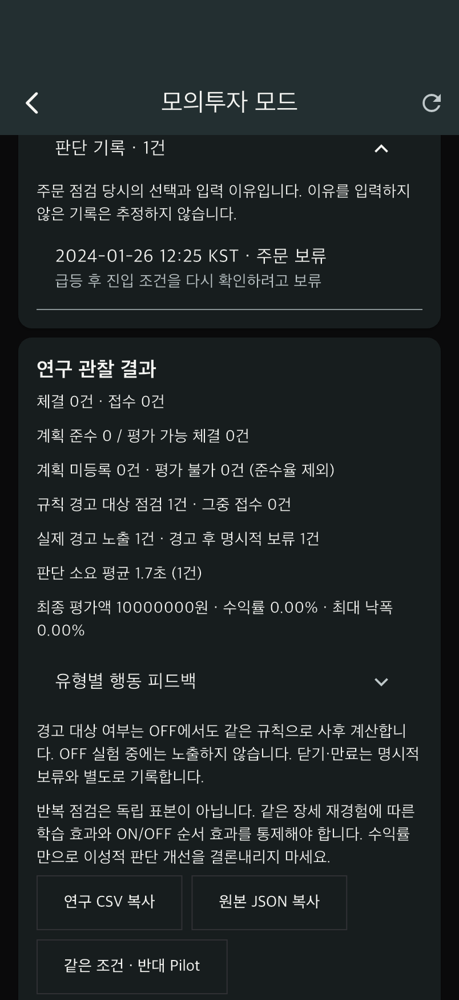

# TradePilot 개발 재개 보고서 · 2026-11-02

## F-01 시세 반영 시간 검증 마무리

지난 작업에서 실제 실행한 `client/docs/latency-review/measurement.json`을 확인했다.

| 지표 | 측정값 |
|---|---:|
| 서로 다른 시세 표본 | 20건 |
| 화면 표시 확인 | 20건 |
| 누락 및 미해결 | 0건 |
| 평균 | 37.182ms |
| 95백분위 | 52.283ms |
| 최대 | 55.141ms |

측정 범위는 **JSON 해석을 마친 WebSocket 이벤트 전달부터 Flutter의 해당 가격 레이아웃·그리기 완료까지**다. iPhone 17 iOS 시뮬레이터의 debug 빌드, 로컬 FastAPI·임시 PostgreSQL, 고유한 합성 가격 20건을 사용했다. 평균 2초 화면 반영 목표는 이 환경의 해당 구간에서 충족했다. 거래소 수신·외부 통신·물리 화면·AI 추론 및 실제 기기 성능은 포함하지 않으므로 명세의 전체 시세/분석 지연 완료로 확대 해석하지 않는다.

- 측정 서버: `server/tool/serve_latency_test.py` (테스트 전용 합성 가격)
- 측정 앱: `client/integration_test/quote_latency_test.dart`
- 원본 측정: [measurement.json](client/docs/latency-review/measurement.json)

## F-05 보류 이유와 판단 기록

과거 장세 실험의 주문 확인 화면에서 이유를 입력한 뒤 ‘주문 보류’를 선택하면, 입력 이유가 버려지던 경로를 수정했다.

- 이유 입력은 보류 시 **선택 사항**이다. 경고 확인 체크박스나 3자 이상 이유 조건으로 보류를 막지 않는다.
- 서버가 해당 점검의 `decision_reason`을 저장한다. 요청 재전송은 같은 결과를 반환하고 중복 주문을 만들지 않는다.
- 실험 종료 후 **판단 기록**에서 점검 시각·보류/진행/닫기/만료/미결 상태·사용자가 입력한 이유를 확인한다.
- 진행 중에는 종료 후 판단 목록을 반환하지 않는다. 기존 OFF 내부 행동 평가 비공개 정책도 유지한다.
- 빈 이유는 ‘입력한 이유 없음’으로 표시한다. 창을 닫으면 명시적 보류로 세지 않으며 이유를 추정하지 않는다.
- CSV `reason`과 원본 JSON에 보류 이유를 포함한다. CSV에서는 수식으로 해석될 수 있는 텍스트 앞에 작은따옴표를 붙이고 JSON에는 원래 텍스트를 보존한다.
- 이전 주문 진행 기록은 보존된 주문 이유를 읽어 표시한다. 기존 DB 테이블/마이그레이션 변경은 없다.

이번 저장 확장은 `/v1/replay` 과거 장세 실험 대상이다. 일반 모의계좌의 `/v1/orders/check/{id}/dismiss`는 이번 작업에서 보류 이유 저장 API로 변경하지 않았다. 연구 내보내기의 자유 서술문은 참가자의 개인정보가 포함될 수 있으므로 외부 제공 전 내용을 검토한다.

## 검증 및 재개

- 관련 서버 테스트 29개 통과: 재생 실험·쌍 집계·보류 이유·재시도·빈 이유·닫기 구분·CSV 수식 방지.
- 관련 Flutter 테스트 9개 통과: 확인창 결과 전달, 과거 재생, 종료 후 판단 기록.
- Ruff 검사 통과. 지난 측정 테스트의 불필요한 import 경고를 제거했다.
- 기존 개발 결과·연구 한계: [2026-11-01 보고서](DEVELOPMENT_REPORT_2026-11-01.md).
- 실제 과거 2020/2024 5분봉과 사람 대상 효과 검증은 여전히 미완료다.

- Flutter 정적 분석 최종 정상. iPhone17 네이티브 통합 검증도 통과했다.
- 일반 시연 서버 `http://127.0.0.1:18081` ready 확인, 기존 `.demo/postgres` 보존. 임시 테스트 서버18080 정리.

### iOS 확인 화면

아래는 합성 시세를 자동 조작한 기능 검증 화면이며 실제 참여자 연구 자료가 아니다.

다음 재개 항목: 일반 모의계좌의 보류 이유 저장 경로 일관성 보완, 연구 참여자 절차·실제 데이터 확보 준비. 새 기능 사용은 로그인 → 모의투자 → 실험에서 주문 점검 후 이유 입력·보류 → 종료 → 판단 기록 순서다.
