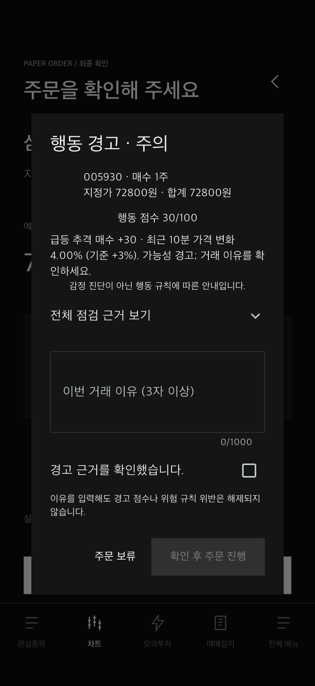
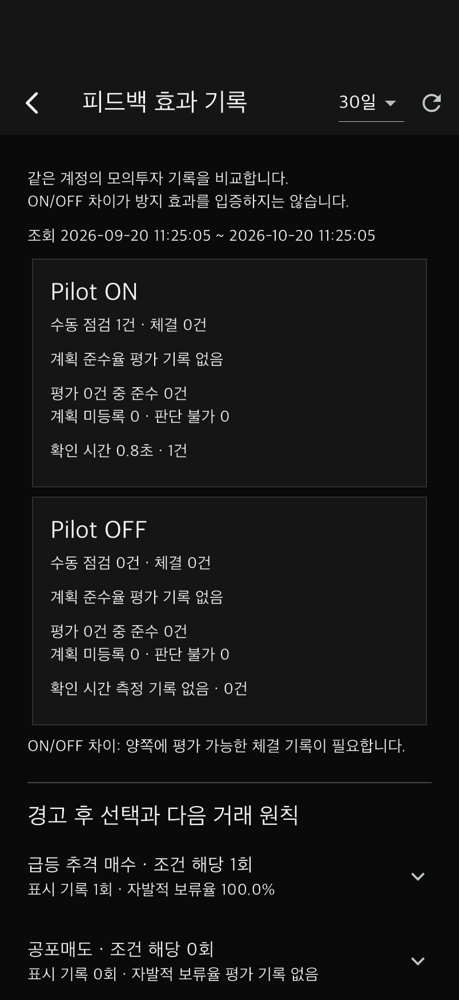
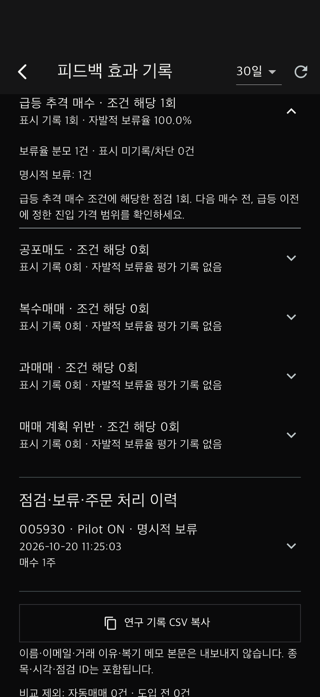

# TradePilot 행동 점검·피드백 연구 준비 개발 결과

작성일: 2026-10-20 (Asia/Seoul)

이번 구현은 기능명세서 v3의 F-03(뇌동매매 점검), F-04(위험 점검), F-05(매매일지·피드백), R3(Pilot ON/OFF)를 기준으로 한다. 규칙 기반 경고와 실제 사용자의 감정 진단을 구분한다. 연구를 위해 새 예측 확률이나 임의의 행동 가중치를 도입하지 않았다.

## 구현 내용

| 명세 근거 | 적용 내용 |
|---|---|
| 4.2 행동 판단 | 기존 급등 추격·공포매도·복수매매·과매매·계획 위반 규칙과 사전 계획 예외 유지 |
| 4.3 공포매도 UI | ‘잠깐, 계획된 매도인가요?’ 제목, 10분 가격 변화, 보유 평가수익률, 저장된 손절가와 계획 평가 근거 표시 |
| 4.3 간결한 확인 | 주의/높음의 이유·확인 요건 유지. 표시 기록 전송은 주문 UI를 기다리게 하지 않음 |
| 5 위험 점검 | OFF에서도 잔액·한도·쿨다운·거래 정지 유지. 최종 제출 시 재검사와 중복 방지 유지 |
| 6 당시 기록 보존 | 규칙 버전·기준값·주문 당시 분석 저장. 최초 표시 시각과 명시적 결정 시각을 덮어쓰지 않음 |
| 6 반복 행동 피드백 | 유형별 조건 해당 횟수·화면 표시 기록·보류·접수·거절·취소·체결·미결정·만료 구분 및 다음 거래 원칙 제시 |
| 6 원칙 준수 + R3 | 같은 계정의 수동 거래를 주문 당시 Pilot ON/OFF로 분리하여 평가 가능한 체결의 계획 준수율·표본 수·확인 시간 비교 |
| 연구 기록 활용 | 인증된 본인 기록의 CSV 복사. 기준값·종목·시각·판단 불가·표시 여부·결정·실제 주문 상태 포함 |

## 사용 방법

1. 서버 연결 모드로 로그인한다. 화면 전용 데모 모드에는 새 연구 기록이 저장되지 않는다.
2. 종목 선택 → 매수/매도 → 주문 확인 → 행동 경고·이유 확인 순으로 진행한다.
3. 명시적인 **주문 보류** 버튼을 누르면 보류 결정이 저장된다. 창 바깥 탭·뒤로 가기로 닫은 것은 명시적인 보류로 세지 않는다.
4. 진행하면 접수·거절 결과를 기록하고, 이후 실제 모의 체결·취소 상태를 연결한다. 같은 주문 키 재전송은 기록을 늘리지 않는다.
5. **매매일지 → 상세(분석 탭) → 피드백 효과 기록 · ON/OFF 비교**를 연다.
6. 7/30/90일을 선택하여 비교하고 **연구 기록 CSV 복사**로 텍스트를 복사한다. 텍스트 편집기에 붙여 넣고 UTF-8 `.csv` 파일로 저장한다.

‘피드백 효과 기록’은 효과를 산출·입증했다는 뜻이 아니다. 화면에는 관찰 자료임을 명시하며, 자료가 없으면 ‘평가 기록 없음’으로 표시한다. UI의 ON/OFF는 주문 전 행동 경고 스위치이며 AI·일지 전체를 켜고 끄는 실험 조건이 아니다.

## 집계 정의

- **계획 준수율:** 해당 기간의 수동 점검에 연결된 체결 주문 중, 저장된 계획을 평가할 수 있는 주문만 분모에 포함한다. 미등록·판단 불가·거절·취소·미체결은 제외하고 별도 수로 표시한다.
- **ON/OFF 차이:** `ON 계획 준수율 − OFF 계획 준수율`을 %p로 표시한다. 양쪽의 평가 가능한 체결이 없으면 산출하지 않는다.
- **유형별 자발적 보류율:** 경고 화면 표시가 기록되고 위험 규칙을 통과한 점검 중 `명시적 보류 / (보류 + 접수 + 체결 + 접수 후 취소)`이다. 상태는 상호 배타적이며, 거절·차단·미결정·만료는 분모에서 제외한다. 이 값은 ‘뇌동매매 방지율’이 아니다.
- **확인 시간:** 서버가 화면 표시 보고를 받은 시점부터 보류/제출 결정을 받은 시점까지. 시세 수신 지연·전체 주문 소요 시간·사용자 인지 시간과 다르며 네트워크 지연이 포함된다. 표시 누락·만료 이후 결정은 시간 집계에서 제외한다.
- **점검 단위:** 재전송된 제출은 하나지만 새로 점검한 주문은 다른 시도이다. 보류 뒤 다른 점검으로 재주문할 수 있으므로 같은 의도의 거래 방지가 증명된 것은 아니다.
- **ON/OFF의 행동 경고:** OFF를 0점/안전으로 간주하지 않는다. OFF의 행동 점수는 내보내기에서도 빈 값이다. OFF와 ON의 경고 비율을 비교하는 지표는 제공하지 않는다.
- **대상:** 현재 인증된 계정의 수동 점검만 포함한다. 자동매매와 새 기록 도입 전 자료(`legacy`)는 따로 세고 비교에서 제외한다. 예전 기록의 표시·반응 시각을 추정해서 채우지 않는다.

## 연구에 사용할 때

동일 참여자는 동일 계정과 참여자 번호를 사용해야 한다. CSV에는 계정 이름·이메일을 넣지 않으므로 참여자 번호와 회차/조건은 연구자가 별도로 관리한다. 개인적인 거래 이유·복기 메모 본문도 CSV에서 제외한다. 종목·시각·점검/주문 ID는 포함되므로 완전 익명 자료로 간주하지 않는다.

사용자가 자발적으로 선택한 ON/OFF 차이에는 시장 상황, 거래 종류, 계획 유무, 숙련도, 사용 순서 등이 섞일 수 있다. 논문에서 ‘피드백 때문에 얼마나 개선되었는가’를 주장하려면 별도로 정한 실험 설계와 실제 참여자 자료가 필요하다. 현 단계는 그 자료를 보존·검토·내보내는 소프트웨어 구현이다. 만족도 조사 도구는 `docs/user-study/`에 있으며 실사용자의 실제 응답으로 채워야 한다.

현재 시장 시세는 합성 시연 자료이다. 캡처나 자동화 검증의 보류율 100%는 합성 시나리오 한 건의 동작 확인이며 연구 결과가 아니다.

## AI 예측 상태

F-02의 5분봉·1시간 방향 확률, MA/RSI/MACD 입력, 시간순 검증·기준모델 비교·판단 보류 구조는 기존 구현을 유지한다. 실제 학습 CSV와 검증된 모델은 아직 없다. 따라서 현재 화면은 모델 학습 대기를 표시하며 임의의 예측 확률을 제공하지 않는다.

실제 AI 예측을 함께 시험하려면 `server/docs/csv-training.md`에 따라 과거 OHLCV 데이터로 학습·검증하고, 같은 출처의 새 완료 봉을 공급해야 한다. 앱의 개인 CSV 백테스트 데이터 업로드와 AI 모델 등록은 서로 다른 경로이다. 이번 연구용 행동 경고는 AI 학습 모델 없이도 동작한다.

## API·데이터 변경

- `POST /v1/orders/check/{check_id}/presented`: 본인 수동 점검의 최초 화면 표시를 서버 시각으로 기록. 재호출 시 원래 시각 반환.
- 기존 `POST .../dismiss`: 최초 명시적 보류 시각 보존.
- 기존 주문 제출: 유효한 점검의 결정 시각과 실제 주문 ID 연결. 제출 재전송 시 원래 주문 유지.
- `GET /v1/feedback?days=30&offset=0`: 본인 집계·유형별 피드백·점검 이력(50건씩).
- `GET /v1/feedback/export?days=30`: 본인 CSV 텍스트·조회 구간·제외 수·집계 설명. 기간 1~365일, 한 번에 최대 10,000건. 초과 시 기간을 줄이도록 오류 반환.
- Alembic head: `20261022_feedback`. 기존 자료는 `legacy`; 신규 수동/자동 점검은 각각 `manual`/`automation`.
- CSV의 `snapshot_at`은 내보내기 기준 시각이며 미체결의 상태는 이후 바뀔 수 있다. `rule_version`, `policy`, `rule_items`는 당시 기록이고 이후 기준으로 재분류하지 않는다.

## 실행 및 마이그레이션

프로젝트 루트에서 `./tool/start_demo_server.sh`를 실행하면 기존 로컬 시연 DB에 마이그레이션이 적용된다. 앱은 `./tool/start_ios_demo.sh <시뮬레이터_ID>`로 시작한다.

별도 개발 DB를 쓰는 경우 서버를 중지하고 `server` 폴더에서 `.venv/bin/alembic upgrade head`를 적용한 뒤 서버를 다시 시작한다. 개인 `.env` 개발 DB에 이 작업을 자동 적용하지 않는다.

## 검증

- 서버 전체 테스트 **117개 통과**: 신규 9개. 사용자 격리, ON/OFF 분모, 보류/차단/거절/취소/체결 구분, 표시·결정 시각의 재호출 불변, 도입 전/자동매매 제외, CSV 내용·페이지 나눔 검증.
- Flutter 단위·위젯 테스트 **41개 통과**: 신규 4개. 자료 없음·오류 재시도·기간 변경·CSV 복사·공포매도 근거·명시적 보류와 단순 창 닫기 구분 검증.
- Flutter analyze, Ruff 및 `git diff --check` 통과.
- iPhone 17 실제 앱 + FastAPI + 임시 PostgreSQL 통합 테스트 통과: 관심종목에서 삼성전자 선택 → 매수 점검 → 30점 경고 표시 → 보류 → 실제 주문 0건 → 피드백 집계 → CSV 내용 검증.
- 검증 캡처는 실제 앱 화면이며 합성 시세·자동화 입력이다. 실제 참여자 연구 결과가 아니다.
- 이번 변경의 Android 네이티브 실행 검증은 수행하지 않았다. 서버 테스트에 기존 Starlette/httpx 사용 중단 예고 경고 1건이 있으나 실패는 없다.

| 경고 확인 | 동일 계정 비교 | 경고 후 선택·원칙 |
|---|---|---|
|  |  |  |

기계 판독용 합성 시험 기록: [synthetic-results.json](client/docs/feedback-review/synthetic-results.json).

네이티브 통합 검증 재현은 프로젝트 루트에서 다음 두 터미널로 실행한다. 시험 서버는 임시 DB를 생성·삭제하며 실제 시연 DB와 분리된다. FOMO 합성 기준 시세는 서버 시작 후 약 3분의 시험 구간에 맞춰 준비되므로 컴파일이 오래 걸렸다면 시험 서버를 재시작한다.

```sh
# 터미널 1
cd server
PYTHONPATH=. .venv/bin/python tool/serve_feedback_test.py
```

```sh
# 터미널 2
client/tool/flutterw drive --driver=test_driver/feedback_driver.dart --target=integration_test/feedback_test.dart -d <시뮬레이터_ID> --no-pub
```


로컬 시연 DB에 새 마이그레이션을 적용하고 `127.0.0.1:18081` 서버를 실행했다. 임시 통합시험 DB는 종료 시 삭제되며, 합성 시험 결과는 실제 참여자 자료에 합치지 않는다.
