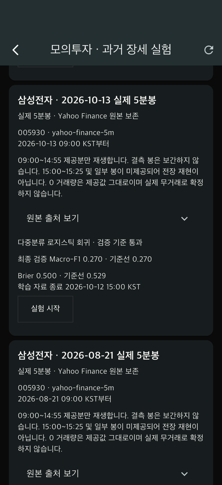
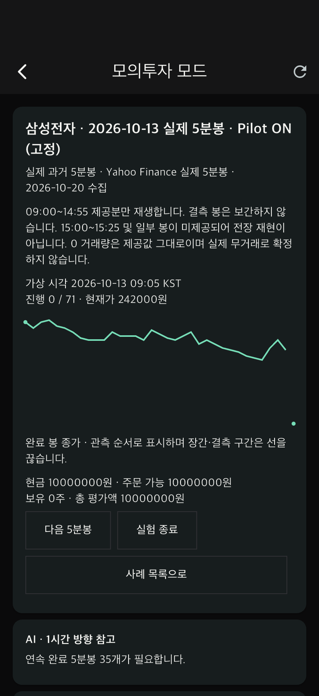
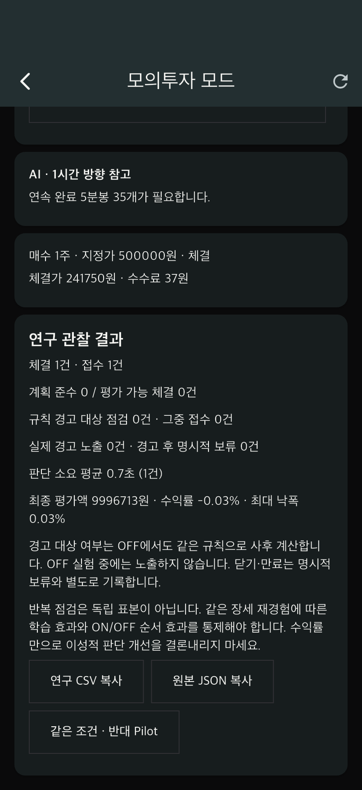

# 실제 과거 5분봉 적용 보고서

작성일: 2026-10-20

## 적용 범위

사용자 선택에 따라 **5분봉 실험을 유지**했습니다. 일봉을 5분봉처럼 나누거나 합성 가격을 실제 가격으로 바꾸어 표기하지 않았습니다. Yahoo Finance에서 받은 삼성전자(005930.KS)의 실제 관측 OHLCV를 고정 파일로 보존하고, 모의투자 기본 사례로 연결했습니다.

**이번 자료는 2026년 최근 사례입니다. 기존에 소개한 2020년 코로나19 충격 및 2024년 8월 5일 급락의 실제 5분봉은 확보하지 못했습니다.** 해당 사건은 앱에서 `2020·2024 사례 · 실제 5분봉 확보 대기`로 별도 표시합니다. 기존 합성 사례와 실험 기록은 삭제하거나 실제 기록으로 바꾸지 않고 선택 표시로 보존합니다.

## 데이터와 출처

- 5분봉: [Yahoo Finance 삼성전자 chart 응답](https://query1.finance.yahoo.com/v8/finance/chart/005930.KS?interval=5m&range=60d&includePrePost=false). 2026-10-20 수집 응답의 symbol, KRW, Asia/Seoul, 5m 메타데이터를 확인했습니다. 원본은 `yahoo-005930-5m.json.gz`에 보존했습니다. 링크를 다시 조회하면 이동하는 기간의 다른 데이터가 반환되므로 **재현에는 로컬 원본을 사용**합니다.
- 일봉 대조: [네이버 삼성전자 일봉 응답](https://fchart.stock.naver.com/sise.nhn?symbol=005930&timeframe=day&count=3000&requestType=0). 사례 당일 첫 시가 일치 및 분봉 고저가가 일봉 범위 안에 드는지만 검사했습니다. 일봉은 재생·학습·추론 입력으로 사용하지 않았습니다. 이 검사로 모든 분봉의 정확성이 인증되는 것은 아닙니다.
- [고정 자료 목록과 SHA-256](server/app/data/historical/2026-10-20/manifest.json): 원 응답, 정규화 사례 JSON, 학습 모델의 해시를 보존합니다. 압축 파일의 원 응답 해시는 압축 해제한 바이트 기준입니다.
- 원 Yahoo 응답 SHA-256: `3a330900c168da6d38ddd84d1549a7137c11d41b879547c5aa9dec7276402b1d`.

원 응답에서 2026-07-22~2026-10-19의 유효 봉 **4,232개**를 추출했습니다. 수집 당일의 미완성 가능 자료 37개와 OHLCV 일부가 null인 16개를 제외했습니다. 원본은 제외 전 그대로 보존합니다. 0 거래량 14개는 제공값을 유지하며, 실제 무거래를 확인한 것으로 해석하지 않습니다. 값의 반올림·보간·일봉 재표본화는 하지 않았습니다. 제공자의 수정주가 정책 및 모든 봉을 거래소 체결 자료와 대조하는 검증은 별도로 완료하지 않았습니다.

| 삼성전자 사례 | 재생 봉 / 정규장 78개 | 사례 이전 학습 입력 봉 | AI 상태 |
|---|---:|---:|---|
| 2026-07-29 | 67 | 355 | 유효 학습 표본 부족 · 예측 없음 |
| 2026-08-21 | 72 | 1,502 | 검증 기준 미달 · 예측 보류 |
| 2026-10-13 | 72 | 3,878 | 기존 검증 기준 통과 · 조건 충족 시 확률 제공 |
| 2026-10-15 | 66 | 4,022 | 기존 검증 기준 통과 · 조건 충족 시 확률 제공 |

봉의 시각은 **시작 시각**입니다. 앱에는 KST로 표시합니다. 원 응답의 제공 구간은 대체로 09:00~14:55이며, 15:00~15:25의 6봉은 모든 사례에서 없습니다. 7월 29일은 12:35~12:55의 5봉, 10월 15일은 12:40~13:00 및 14:55의 6봉도 빠져 있습니다. 따라서 **정규장 전체를 완전히 복원한 자료가 아닙니다.** 누락 시각은 사례 `coverage.missing_open_times`에 남겼습니다.

실제 관측 자료의 7월 29일에는 10분 종가 변화가 +3% 및 -3%를 넘는 구간이 있습니다. 다른 세 사례에는 관측 가능한 연속 10분 구간에서 ±3%를 넘는 변화가 없어 급등 추격/급락 매도 경고가 매번 발생하지 않습니다. 경고를 만들기 위해 실제 가격이나 기능명세의 임계값을 변경하지 않았습니다. 사례 선택은 최근 제공 범위에서의 사후 선택이며 무작위 시장 표본이 아닙니다.

## 앱 및 서버 동작

1. 서버 연결 앱에서 하단 **모의투자**를 누릅니다.
2. 인증된 `POST /v1/replay/historical`이 사용자에게 사례 4개를 한 번 등록합니다. 다시 들어가도 카탈로그 ID와 데이터 해시가 같은 사례는 중복 생성하지 않습니다. 앱 진입 때 외부 사이트를 다시 수집하지 않습니다.
3. 실제 5분봉 표시·출처·누락 안내를 확인하고 **실험 시작**을 누릅니다. 초기 현금 1,000만 원, 보유 0주로 시작합니다.
4. **다음 5분봉**으로 진행하고 주문을 점검합니다. 연속한 다음 관측 봉의 시가가 지정가 조건을 충족하면 체결합니다. 관측 사이에 결측/장간 단절이 있으면 미체결 주문을 취소하고, 그 구간 체결을 추측하지 않습니다. 보유 포지션은 다음 실제 관측값으로 평가합니다.
5. 종료 후 **연구 CSV 복사**, **원본 JSON 복사**로 기록을 저장합니다. JSON에는 원본 출처·해시, 사용한 봉, 모델, 누락 정책 및 실험 이력이 포함됩니다. 같은 조건의 반대 Pilot 실험도 기존처럼 가능합니다.

진행 중 응답은 현재까지의 봉만 포함합니다. 당일 일봉 대조 자료에는 미래 종가가 있으므로 사례 목록/실험 화면에는 보내지 않고, 종료 후 재현 JSON에만 포함합니다. 기존 일반 모의계좌와 잔고·주문은 독립적입니다. 이 교체는 **과거 장세 재생 모드**에 적용되며, 일반 시연 계좌의 demo 시세나 증권사 연결을 실거래 데이터로 바꾸지는 않습니다.

## AI 해석

모델은 기존 순수 Python 다중분류 로지스틱 회귀입니다. 사례 첫 공개 봉 이전 데이터로만 시간순 학습·검증하고, 모델과 그 학습 구간 해시를 동결했습니다. 일봉이나 사례 이후 가격으로 학습하지 않았습니다.

| 사례 모델 | 최종 검증 표본 | Macro-F1 / 기준선 | Brier / 기준선 | 최고 확률 65% 미만 비율 |
|---|---:|---:|---:|---:|
| 08-21 | 100 | 0.236 / 0.247 | 0.652 / 0.589 | 100% |
| 10-13 | 272 | 0.270 / 0.270 | 0.500 / 0.529 | 91.54% |
| 10-15 | 282 | 0.255 / 0.255 | 0.552 / 0.563 | 95.74% |

**통과한 두 모델도 상승·하락 분류 성능을 입증하지 못했습니다.** 최종 검증에서 최대 확률 클래스가 모두 보합으로 나왔고 Macro-F1은 기준선과 같습니다. 기존 품질 기준(기준선보다 F1이 나쁘지 않고 Brier가 나쁘지 않음)을 만족한 것이며, 높은 실용 예측력의 증거로 보고하면 안 됩니다. 65% 확률 기준 때문에 방향 판단이 보류되는 비율도 높습니다.

추론에는 연속 완료 5분봉 35개가 필요합니다. 장 시작 직후와 결측 이후에는 예측을 보류합니다. 확보된 재생 자료 종료까지 1시간이 남지 않는 구간도 보류합니다. 이 때문에 모델이 있어도 화면에서 항상 예측을 보이는 것은 아닙니다. 행동 피드백은 유효한 규칙 입력이 있으면 별도로 동작합니다.

논문에서는 **동일한 실제 시세와 동일한 AI 정보 아래 Pilot 행동 피드백 ON/OFF를 비교**할 수 있습니다. 소프트웨어 테스트 통과는 사람의 뇌동매매 감소 효과나 통계적 유의성을 입증하지 않습니다. 목표 지표·분석 단위·순서 효과·결측 제외 기준은 참여자 실험 전에 정해야 합니다.

## 재현 및 검증

서버 작업 디렉터리 `server`에서:

```sh
.venv/bin/python -c 'from app.services.historical_data import load_bundle; print(len(load_bundle()))'
.venv/bin/pytest -q tests/test_historical_data.py tests/test_replay.py
```

새 스냅샷을 재작성하려면 보존한 원 Yahoo JSON과 네이버 XML을 압축 해제한 후 `tool/build_historical_catalog.py --yahoo <json> --naver <xml> --output <새 폴더>`를 사용합니다. 기존 출력 폴더 덮어쓰기는 거부합니다. 모델 생성 시각 등 메타데이터는 재빌드 시 달라질 수 있으므로 정확히 같은 연구 실행은 보존된 모델 JSON을 사용합니다.

- 서버 전체 회귀 135개 통과 후 실제 급등 ON/OFF 검증 1개를 추가했습니다. 신규 실제 데이터 테스트 10개도 모두 통과하여, 이번 검증의 서로 다른 테스트는 총 136개입니다. 테스트용 임시 PostgreSQL을 사용했습니다.
- Ruff 검사 통과, Flutter 정적 분석 이상 없음, Flutter 전체 44개 통과. 차트 단절 표시 수정 후 관련 위젯 3개를 재검증했습니다.
- iPhone 17 네이티브 통합: 실제 사례 자동 등록 → 현재까지만 차트 공개 → 다음 시가 체결 → CSV/JSON 내보내기 → 동일 조건 Pilot OFF 연결까지 통과했습니다. 차트 단절 표시 수정 후 재실행도 통과했습니다.
- 원본 OHLCV와 정규화된 모든 값의 정확한 일치, 잘못된 봉 간격 거부, null 제외/보간 금지, 원본 변조 시 등록 거부, 학습 시간 분리, 미래 가격 미노출, 실제 결측 시 주문 취소, 기존 기록 보존과 중복 방지를 확인했습니다.
- **스크린샷 및 JSON은 자동 소프트웨어 테스트 결과이며 사람을 대상으로 얻은 논문 실험 자료가 아닙니다.** 체결/계좌 숫자를 연구 효과로 인용하지 마세요.

| 사례 선택 | 실제 시세 재생 | 테스트 결과 내보내기 |
|---|---|---|
|  |  |  |

[자동 검증 증거 JSON](client/docs/historical-review/verification-results.json)

## 원래 유명 장세를 추가하려면

2020년 3월 및 2024년 8월 5일의 **시간대가 명시된 실제 5분 OHLCV**, 그리고 AI 학습을 위한 사건 이전 여러 거래일 자료가 필요합니다. 해당 기간을 보유한 제공처의 CSV 또는 사용 가능한 API 권한이 확보되면 기존 CSV 등록 경로로 추가할 수 있습니다. 일반적인 분봉 API가 수년 전 해당 기간을 반드시 보관한다고 가정하지 않습니다. 이번 Yahoo 수집 범위만으로 이 두 과거 사건을 재현할 수 없습니다.

### 데이터 제공처 추가 확인 (2026-11-01)

- 한국투자증권의 [공식 Open API 샘플 저장소](https://github.com/koreainvestment/open-trading-api)는 `주식일별분봉조회` 예제에서 종목 코드, 날짜, 시각을 받아 분봉을 조회하는 경로를 보여줍니다. 이는 날짜 지정형 수집을 시험할 수 있는 후보입니다. 다만 공개 예제만으로 2020년 또는 2024년 자료의 보존 범위·호출 가능 여부를 확인할 수 없어, 해당 날짜 데이터가 실제로 내려온 것으로 취급하지 않습니다.
- 같은 저장소는 KIS Developers 계정에서 발급한 App Key와 App Secret을 이용한 인증을 안내합니다. 현재 이 프로젝트에는 사용자의 KIS 자격증명이 등록되지 않았으므로 인증된 수집 요청을 실행하지 않았습니다. 보안 키를 코드나 보고서에 기록하지 마세요.
- [KRX Open API 서비스 목록](https://openapi.krx.co.kr/contents/OPP/INFO/service/OPPINFO004.cmd)이 명시한 주식 시세 서비스는 2010년 이후 **일별 매매정보**입니다. 해당 공개 API 목록은 연구에 필요한 5분봉을 제공한다고 밝히지 않습니다.
- KIS API 시세 이용은 계좌 보유 개인의 자기 자산 투자 목적 등 이용 조건을 따릅니다. 연구 파일을 배포하거나 외부에 공유하기 전에 원 제공처의 이용약관·재배포 권리를 확인해야 합니다.

따라서 다음 수집 단계는 (1) KIS Developers 계정의 날짜 지정 분봉 API를 2020/2024 대상일과 인접 학습일에 대해 실제 호출해 응답 범위를 검증하거나, (2) 해당 기간의 1분/5분 원자료를 보유한 허가된 제공처에서 CSV를 받아 앱의 기존 CSV 등록 경로로 검증하는 것입니다. 1분 자료를 받는 경우에도 각 5분 구간의 실제 분별 OHLCV가 완전할 때만 묶어야 하며, 빈 구간을 보간하거나 일봉을 분봉으로 환산하지 않습니다. API 호출 결과 또는 검증 가능한 원자료 파일이 들어오기 전까지 앱의 2020·2024 사례 상태는 **실제 분봉 확보 대기**로 유지합니다.
