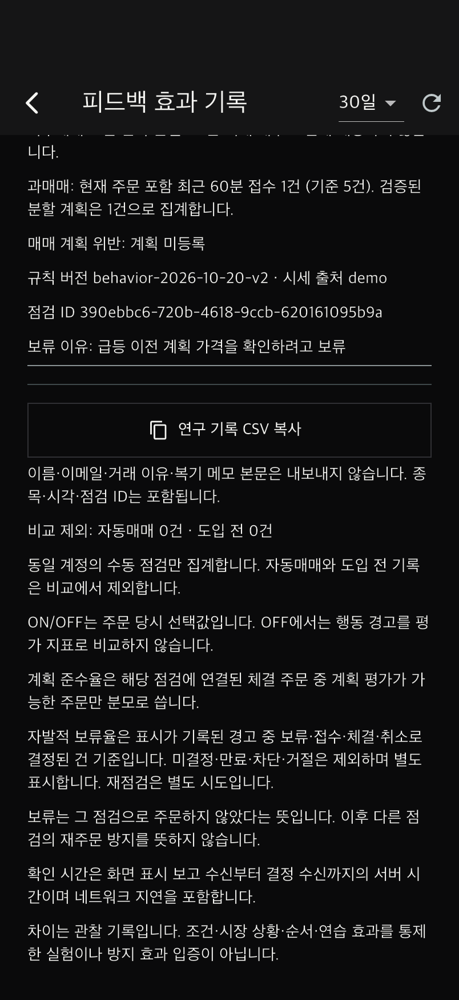

# 일반 모의계좌 보류 이유 기록 · 2026-11-02

기능명세 F-05의 사용자 판단 보존을 일반 모의계좌에 보완했다. 과거 장세 재생 실험과 별도로, 일반 주문 점검에서 사용자가 입력한 이유를 보류 후에도 확인할 수 있다.

## 사용 흐름

1. 일반 모의계좌에서 종목 선택 → 주문 입력 → 주문 점검.
2. 이유를 선택적으로 입력하고 **주문 보류** 선택. 보류를 위해 확인 체크나 최소 글자 수를 요구하지 않는다.
3. **매매일지 → 상세 → 피드백 효과 기록 · ON/OFF 비교**에서 해당 점검을 펼치면 보류 이유가 표시된다.
4. 이유가 없으면 ‘입력한 이유 없음’으로 표시한다. 창 닫기는 명시적 보류로 기록하지 않는다.

## API 및 보존 방식

- `POST /v1/orders/check/{id}/dismiss`는 선택적 JSON `{"reason":"..."}`을 받는다. 최대 1000자, 앞뒤 공백 제거. 본문 없는 이전 클라이언트도 지원한다.
- `order_checks.decision_reason` 별도 컬럼에 저장하므로 당시 위험 점검 스냅샷을 바꾸지 않는다.
- 같은 이유의 재요청은 기존 결정·시각·이유를 반환한다. 이미 저장한 이유를 다른 값으로 바꾸려는 요청은 409다. 본문 없는 재시도는 기존 이유를 지우지 않는다.
- 제출됐거나 소비된 점검, 자동매매 점검을 수동 보류 기록으로 변경하지 못한다. 본인 점검만 접근 가능하다.
- `GET /v1/feedback`의 본인 기록에는 `decision_reason`, `defer_reason_recorded`가 추가된다.
- 일반 피드백 연구 CSV는 기존 자유서술문 제외 정책을 유지하며 `defer_reason_recorded`만 추가한다. 내보낼 열을 명시적으로 선택하여 이유 본문이 섞이지 않게 했다.
- 만료된 점검에 대한 보류 기록은 기존처럼 만료 상태로 분류하며 유효한 확인시간/자발적 보류율에 포함시키지 않는다.

연구용 과거 재생 실험의 CSV/JSON에는 기존과 같이 보류 이유가 포함된다. 두 내보내기의 목적·본문 포함 정책이 다르다.

## DB 업데이트

새 Alembic head: **`20261102_decision_reason`**. 기존 행은 빈 이유로 유지된다. `tool/start_demo_server.sh`가 기존 시연 DB를 보존하며 업데이트한다. 다른 DB를 사용하는 경우 서버 재시작 전에 `server`에서 `.venv/bin/alembic upgrade head`가 필요하다.

이번 시연 DB에 업데이트를 적용하고 일반 시연 서버18081을 재시작했다. 테스트용18080 서버는 종료했다.

## 검증

- 관련 서버 회귀 51개 + 이전 DB 기록 보존 마이그레이션 테스트 1개: **52개 통과**.
- 관련 Flutter 테스트 **13개 통과**, Flutter analyze 및 Ruff 정상.
- iPhone17 네이티브 통합: 실제 API/임시 PostgreSQL에서 급등 경고 → 이유 입력 → 보류 → 본인 피드백 조회 → CSV 본문 제외 검증 통과.
- 불변 이유·재요청·기존 클라이언트 호환·1000자 제한·제출 후 변경 거절·빈 이유·기존 행 보존 검증.
- 아래는 합성 시세를 자동 조작한 소프트웨어 검증 화면이며 참여자 연구 결과가 아니다.

[통합 검증 기록](client/docs/manual-deferral-review/synthetic-results.json)

다음 우선 작업: 논문 실험 절차·목표 지표·관찰 구간·배정 균형·제외 기준을 문서화하고, 실제 참가자 모집 전에 확정할 항목을 구분한다. 2020/2024 실제 5분봉 확보는 계속 외부 의존 사항이다.
