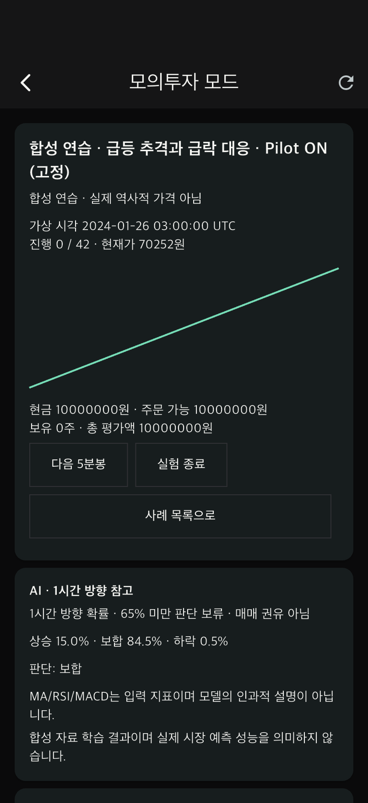
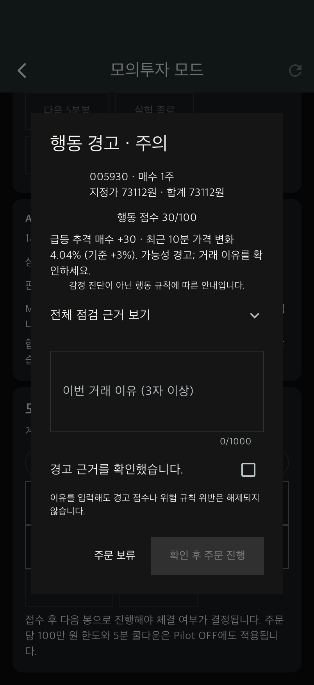
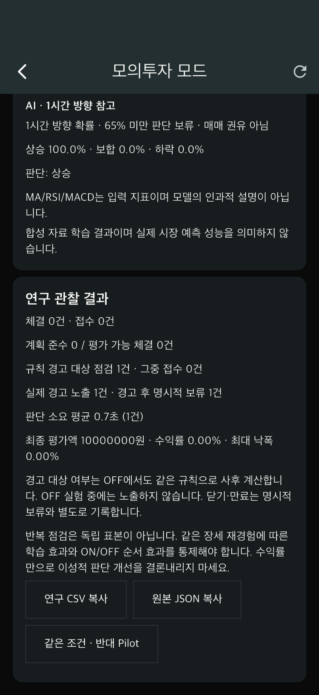

> 2026-11-01 추가 개발: [F-05 예측 복기·유형별 피드백·실험 쌍 보호 및 오프라인 분석](DEVELOPMENT_REPORT_2026-11-01.md). 새 쌍은 정확히 두 실행으로 제한하며, 이전 규칙 스냅샷 없는 기록은 새 쌍으로 다시 시작해야 합니다. 아래 내용은 단계별 이전 보고입니다.

> 최신 변경(2026-10-20): [실제 과거 5분봉 적용 보고서](HISTORICAL_DATA_REPORT.md). 삼성전자 2026-07-29·08-21·10-13·10-15의 Yahoo Finance 실제 OHLCV를 모의투자 기본 사례로 연결했습니다. 2020/2024 사건의 실제 5분봉은 여전히 확보 대기입니다. 아래의 “합성 사례만 있음” 설명은 이전 시점 기록입니다.

# 과거 장세 모의실험 · 로컬 AI 적용 보고서

작성: 2026-10-20. 기능명세 v3 F02–F05를 바탕으로, 사용자가 추가 요청한 역사적 장세 재생 및 동일인 Pilot 비교 실험을 구현했습니다.

> 2026-11-01 업데이트: 첫 Pilot 조건의 서버 무작위 배정, ON/OFF 순서·배정 시각 저장, 동일 요청 재시도 보호, 화면 표시 및 CSV/JSON 내보내기를 추가했습니다. 현재 전체 검증은 서버 140개, Flutter 45개 테스트 통과입니다.

## 구현 내용

- **AI**: 기존 순수 Python 다중분류 로지스틱 회귀(softmax)를 앱의 사례 학습·검증·추론에 연결했습니다. 외부 유료 AI API나 GPU가 필요하지 않습니다. 기기/서버 실행 비용은 별도입니다.
- **빠른 진입**: 서버 연결 앱에서 하단 `모의투자` 탭 → 과거 장세 실험으로 바로 전환합니다. 기존 계좌·전략·자동매매는 `기존 모의계좌 · 전략`으로 접근합니다.
- **사례 보존**: 기존 CSV 관리에서 등록한 개인 데이터를 불변 사본으로 저장합니다. 원 CSV를 삭제해도 사례와 실험은 유지됩니다. 출처·자료 종류·해시·시작 시각을 기록합니다.
- **연습 사례**: 자체 생성한 급등/급락 연습 시세와 해당 자료로 학습한 모델을 준비합니다. 실제 삼성전자 가격이나 역사적 사건을 재현한 데이터가 아닙니다. 숫자 성능을 실제 시장 예측력으로 해석하면 안 됩니다.
- **과거 사건 분류**: 2020년 3월 코로나19 시장 충격, 2024년 8월 5일 증시 급락의 사건 설명과 공식 출처를 제공합니다. 실제 5분봉은 아직 없습니다. CSV 등록 시 사건 분류를 연결할 수 있습니다.
- **독립 계좌**: 현금 1,000만 원, 보유 0주로 시작합니다. 기존 계좌·공용 시세·주문·체결 테이블에 영향을 주지 않습니다. 로그아웃/앱 종료 후 같은 계정으로 이어갈 수 있습니다.
- **가상 시간**: `다음 5분봉`으로만 시장이 진행됩니다. 주문 시점까지 공개된 봉만 차트와 AI에 제공하며 미래 시세는 응답하지 않습니다.
- **체결**: 접수 이후 봉의 **시가**가 지정가 조건을 충족할 때 전량 체결합니다. 미충족 주문은 대기, 취소 시 예약 해제, 종료 시 미체결 자동 취소입니다. 수수료는 편도 0.015%, 원 단위 올림. 세금·슬리피지·유동성·호가 큐는 모델링하지 않습니다.
- **중복 방지**: PostgreSQL 행 잠금, 요청 키, 상태 버전으로 중복 접수·중복 시간 진행을 방지합니다. 응답 유실 시 앱에서 같은 요청을 재시도할 수 있습니다.

## AI 학습 및 명세 준수

입력은 완료된 5분봉 OHLCV의 가격 변화, MA5/20 이격, RSI14, MACD, 거래량 변화입니다. 연속 35봉이 필요하고 단절 시 지표를 초기화합니다. 이후 12봉(1시간)의 수익률이 +0.5% 초과면 상승, -0.5% 미만이면 하락, 그 외 보합으로 라벨링합니다.

사례의 **첫 공개 봉 이전 데이터만** 학습·검증에 사용합니다. 이 구간 안에서 시간순 60/20/20 분할, 미래 라벨이 경계를 넘는 표본 제거, 검증 구간 온도 보정, 최종 검증 및 3개 walk-forward 평가를 실행합니다. 최종 검증 macro-F1 및 Brier가 학습 구간 클래스 비율 기준선보다 나쁘면 예측을 보류합니다. 최고 확률 65% 미만도 방향 판단을 보류합니다. 장 종료까지 1시간 미만, 부족한 연속 봉, 학습 시점 이후가 아닌 데이터에서는 예측하지 않습니다.

모델 파일은 실행 가능한 pickle이 아닌 DB의 JSON 파라미터로 저장합니다. 재생 모델의 기존 `csv_sha256` 필드는 정규화한 학습 구간 OHLCV JSON의 SHA-256입니다. 원 업로드 CSV의 바이트 해시는 사례의 `dataset_sha256`에 별도로 보존합니다. 실험이 한 번이라도 시작된 사례는 모델을 새로 학습하거나 교체할 수 없습니다. 실제 데이터 등록은 원 가격·휴장일·수정주가·이용권한을 자동 인증하지 않습니다.

학습 구간은 최대 5,000봉, 최소 240개 라벨 표본 및 세 클래스가 필요합니다. 재생 구간은 최대 500봉입니다. 단일 거래일 CSV만으로는 학습 조건이 부족할 수 있으므로 사건 이전의 여러 거래일도 함께 준비해야 합니다. 모델 없이 행동 규칙만 시험하는 경우는 앱에 명시됩니다.

## 행동 피드백과 위험 제한

기존 `risk.assess` 공통 함수를 실시간 모의계좌와 재생 계좌가 공유합니다. 재생에서는 가상 시계와 독립 계좌 이력을 입력합니다.

- 급등 추격(+10분 3% 이상), 손실 상태의 급락 매도(-10분 3% 이하), 연속 손실 후 재매수, 과매매, 사전 계획 위반을 평가합니다. 이전 계획에 따른 예외도 적용합니다.
- 점수 30 이상은 이유·확인, 60 이상은 추가 확인을 요구합니다. AI 방향 불일치만으로 행동 점수를 올리지 않습니다.
- 주문당 100만 원, 순실현손실 일일 100만 원, 같은 방향 300초 쿨다운, 현금/수량 예약 및 최종 재점검을 Pilot OFF에도 적용합니다. 이 실험 설정은 고정이며 기존 계정 설정과 별도입니다.
- 시작 전에 하나의 방향에 대한 가격 범위·누적 금액·손절가·분할 여부를 등록합니다. 반대 방향의 주문은 해당 계획이 없는 것으로 처리하며, 계획 미등록은 위반으로 집계하지 않습니다. 여러 방향/여러 종목의 복합 계획은 이번 단일종목 실험 범위 밖입니다.

## 동일인 ON/OFF 비교

1. 한 사례를 고르고 첫 실행에서 `Pilot 순서 무작위 배정`을 선택하면 서버가 ON→OFF 또는 OFF→ON 중 하나를 배정합니다. 배정 조건·순서·시각은 실험 기록에 저장되며 동일 요청 재시도는 같은 실행을 돌려줍니다. 수동으로 첫 조건을 고르는 기존 경로도 유지합니다.
2. 시장을 진행하며 주문하거나 명시적으로 보류합니다.
3. 종료 후 `같은 조건 · 반대 Pilot`을 누릅니다. 같은 사례·모델·초기 자금·위험 설정·사전 계획을 복사하고 계좌/시계를 처음으로 되돌립니다. 두 번째 실행은 첫 실행과 반대 조건이며, 배정된 순서와 같은 실험 쌍 ID를 이어받습니다.
4. 완료된 쌍의 결과를 화면에서 비교하고 CSV 및 JSON을 복사해 파일로 보존합니다.

무작위 순서 기능은 **각 실험 쌍의 첫 조건**을 서버가 정합니다. 소규모 참가자 표본에서 ON→OFF와 OFF→ON의 수가 자동으로 균형을 이루는 블록 무작위 배정은 아닙니다. 실제 연구에서는 참가자별 조건 순서를 사전에 균형 배정하고, 앱의 서버 무작위 배정 기록은 할당 결과의 감사 자료로 활용하는 방안을 지도교수와 확정하세요.

이 설계에서 **AI 정보는 두 조건에 동일하게 제공하고, Pilot 행동 피드백만 조작**합니다. 따라서 본 실험의 개입은 AI 유무 자체가 아니라 규칙 기반 피드백의 유무입니다. Pilot OFF에서도 주문 확인 화면과 공통 위험 제한은 유지됩니다.

OFF에서 경고 대상 규칙은 서버 내부에 별도로 기록하고, **실험 종료 후** 연구 자료에 공개합니다. OFF 진행 중에는 점수·경고 항목을 노출하지 않습니다. ON에서도 실제 경고 표시 여부(`presented_at`)를 기록하므로 점검 생성만으로 노출되었다고 간주하지 않습니다.

| 관찰 지표 | 정의 및 한계 |
|---|---|
| 계획 준수 | 체결 주문 중 계획 조건 평가 가능 주문의 준수 비율. 미등록/평가 불가 제외; 분모 0이면 값 없음 |
| 규칙 경고 대상 점검/접수 | 동일 규칙으로 ON/OFF를 사후 평가. 반복 점검은 독립 표본이 아님 |
| 경고 후 보류 | 실제 경고가 표시된 뒤 `주문 보류`를 누른 횟수. 닫기·만료·미결은 별도 |
| 판단 시간 | 화면 표시 기록부터 명시적 결정까지 실제 서버 시계 경과. 통신 지연·자리 비움이 포함될 수 있음 |
| 수익률·낙폭 | 수수료 반영 계좌 평가액 및 공개 봉 기준 최대 낙폭. 이성적 판단의 직접 지표가 아님 |
| 실험 쌍 | 참가자 UUID, pair ID, 순서, 비교 키, 사례 해시 및 모델 버전으로 동일 조건 확인 |

CSV는 점검별 1행이며 무거래 세션은 헤더만 나올 수 있습니다. CSV와 JSON에는 조건 배정 방식, ON/OFF 순서, 실험 쌍 ID와 순번을 포함합니다. **세션 결과·원본 OHLCV·분석·모델 파라미터·정책·계좌 이력은 JSON도 함께 보존**해야 합니다. 공개 시 참가자 UUID도 필요에 따라 새 연구 ID로 치환하세요.

반복 경험에 따른 학습·순서 효과가 있으므로 ON→OFF만 반복하지 말고 참가자/사례별 순서를 균형 있게 배정하세요. 실제 논문 분석에서는 참가자 또는 실험 쌍을 단위로 삼고, 목표 지표·제외 기준·관찰 구간을 사전에 정해야 합니다. 경고 점수는 감정 진단이나 뇌동매매의 확정 라벨이 아닙니다. 현재 소프트웨어 검증만으로 방지 효과나 통계적 유의성이 입증된 것은 아닙니다.

## 실행 및 사용

터미널 1:

```sh
cd /Users/mumyon/Documents/TradePilot
./tool/start_demo_server.sh
```

이미 18081 서버가 실행 중이면 해당 터미널에서 Ctrl+C로 종료한 뒤 다시 시작합니다. 시작 스크립트가 기존 시연 DB를 보존하며 `20261023_replay`까지 마이그레이션합니다.

터미널 2:

```sh
cd /Users/mumyon/Documents/TradePilot
./tool/start_ios_demo.sh
```

로그인 → 하단 **모의투자** → **합성 연습 사례 준비** → **실험 시작**. 경고 확인 연습에서는 `사전 계획 등록`을 끄고 시작한 뒤 5봉 진행 → 현재가 입력 → 매수 주문 점검하면 +10분 급등 경고가 표시됩니다. 계획을 등록한 경우 해당 조건과 사전 계획 예외에 따라 점수가 달라집니다.

실제 자료 준비 후: **CSV 관리** → 파일 선택·검증·저장(`historical`) → **CSV로 사례 등록** → 사건 분류/첫 공개 봉의 시작 시각 입력 → **AI 학습 / 검증** → 실험 시작. 예: `2024-08-05T12:00:00+09:00`는 CSV에 해당 행이 실제로 존재해야 합니다. CSV 헤더는 아래와 같습니다.

```csv
opened_at,open_won,high_won,low_won,close_won,volume
```

`DEMO_MODE=true`는 저장되지 않는 기존 화면 시연입니다. 이번 모의실험은 `DEMO_MODE=false`와 FastAPI 서버 연결이 필요합니다. 서버와 앱을 모두 최신 코드로 다시 실행하세요.

## 검증

- 서버 전체 **140개 통과** (과거 재생 및 무작위 배정 경로 포함).
- Flutter 정적 분석 정상, 전체 테스트 **45개 통과** (재생 화면 포함).
- **iPhone17 실제 서버 통합 통과**: 하단 탭 진입 → 합성 사례의 실제 로지스틱 회귀 학습 → 가상 시계 진행 → 급등 경고 표시 → 명시적 보류 → 결과/CSV → 동일 조건 Pilot OFF 재시작. 화면 캡처와 자동 검증 기록은 `client/docs/replay-review/`에 저장했습니다.
- 주요 검증: 학습/재생 시간 분리, 미래 봉 변경에 대한 현재 추론 불변, 다음 봉 시가 체결, 현금/주식 예약, 재시도/버전 충돌, 기존 계좌·주문·시세 불변, OFF 위험 제한 및 비공개 경고 기록, 사용자별 접근 제한, CSV 삭제 후 사례 보존, 모델 변경 금지, 경고 표시/보류, 손절 예외.
- Pilot ON/OFF 첫 조건을 서버 무작위 배정하는 경로의 재시도 멱등성, paired-run의 반대 조건·동일 배정 기록, CSV/JSON 증거 내보내기를 추가 검증했습니다.
- HTTP 테스트 실행 중 기존 Starlette/httpx 호환 방식에 대한 deprecation 경고 1개가 있습니다. 테스트 실패는 아닙니다.

## 관련 파일 및 API

- `server/app/services/replay.py`: 사례·학습·가상 시간·계좌·연구 내보내기
- `server/app/services/risk.py`: 공통 행동 정책
- `server/app/ml/pipeline.py`: 재사용한 로지스틱 회귀 학습/검증
- `server/app/replay_schemas.py`, `server/app/api.py`: 입력 검증 및 인증 API
- `server/migrations/versions/20261023_replay.py`: 사례/실험 테이블
- `client/lib/features/trading/presentation/replay_screen.dart`: 앱 실험 UI
- `server/tests/test_replay.py`, `client/test/replay_test.dart`, `client/integration_test/replay_test.dart`: 검증

`GET /v1/replay` 목록, `POST /practice` 연습 자료, `POST /cases` 사례 등록, `POST /cases/{id}/train` 학습, `POST /cases/{id}/runs` 시작, `GET /runs/{id}` 이어하기, `POST /runs/{id}/actions` 점검/표시/접수/보류/진행/취소/종료, `GET /runs/{id}/export` 완료 실험의 CSV+JSON. 모든 경로는 `/v1/replay` 하위이며 인증과 소유권 검사를 적용합니다.

공식 사건 참고: [금융위원회 2020-03-24 금융시장 안정화 방안](https://www.fsc.go.kr/po010101/74223), [금융위원회 2024-08-05 긴급 시장점검회의](https://www.fsc.go.kr/no010101/82809). 이 문서들은 사건 맥락의 출처이며 시뮬레이션 시세 원본이 아닙니다.

## 검증 화면

아래 수치 및 기록은 자동 조작한 합성 연습 테스트이며 사람 대상 연구 결과가 아닙니다.






