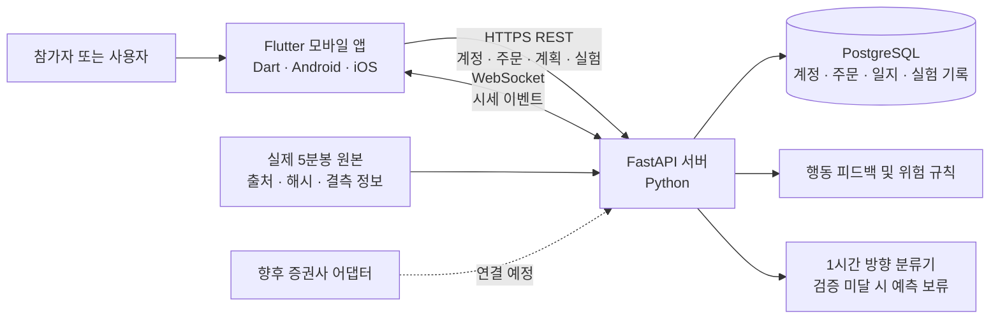

# TradePilot 개발 현황 및 논문 연구 준비 보고서

**작성 기준일:** 2026년 10월 18일  
작성자: 202252046 조병익
**프로젝트:** TradePilot 모바일 모의투자 및 행동 피드백 시스템  
**개발 구성:** Flutter·Dart 모바일 앱, FastAPI 서버, PostgreSQL 데이터베이스, WebSocket 시세 전달 경로

## 1. 보고서 개요

TradePilot은 모의투자 주문 전에 사용자의 매매 계획과 주문 당시의 행동 규칙을 확인하고, 거래 뒤 판단과 결과를 기록하는 모바일 앱이다. 이 프로젝트의 논문 연구 주제는 **동일한 사람이 모의투자를 할 때 행동 피드백이 충동적인 주문을 줄이고 계획에 따른 판단을 돕는지** 살펴보는 것이다.

현재 개발은 핵심 앱 기능과 실험 기록 경로, 실제 과거 5분봉 재생까지 구현한 단계다. 서버·앱의 자동 검증과 시뮬레이터 실행도 완료했다. 그러나 실제 참가자를 대상으로 한 비교 연구는 아직 수행하지 않았다. 따라서 현재 결과는 제품 기능 및 데이터 처리의 작동 여부를 보여 주며, 피드백이 사람의 행동을 개선한다는 효과를 입증하지 않는다.

이번 보고서는 기능명세에 따라 구현된 범위, 논문 연구를 위해 추가한 비교 기능, 실제 데이터와 모델 검증, 현재 앱 화면, 남은 연구 과제를 설명한다. 본 문서는 발표자가 읽는 대본이 아니라 심사자와 지도교수가 개발·연구 현황을 검토하기 위한 자료다.

## 2. 연구 배경과 목적

급격한 가격 변동은 투자자가 사전에 정한 계획보다 눈앞의 움직임에 반응하게 만들 수 있다. 가격 급등 뒤 뒤늦게 매수하는 추격 주문, 손실 상태에서 급락을 보고 계획 없이 매도하는 행동, 손실을 만회하려는 반복 주문 등이 그 예다. 이 연구는 사용자를 감정 상태로 진단하거나 거래를 무조건 차단하는 대신, 주문 직전에 판단 근거와 사전 계획을 다시 보여 주는 개입을 설계한다.

**연구 질문:** 같은 참가자가 같은 과거 시세와 같은 초기 조건을 경험할 때, TradePilot의 주문 전 행동 피드백을 제공하면 피드백을 제공하지 않을 때보다 계획 이탈 주문이 줄고, 경고 대상 상황에서 명시적 보류와 계획 준수 행동이 늘어나는가?

여기에서 ‘뇌동매매’는 직접 관찰할 수 있는 진단값이 아니다. 그러므로 본 연구에서는 앱 규칙에 해당하는 행동과 참가자의 선택을 관찰한다. 계획 준수, 경고 후 보류, 판단 시간과 반복 주문 등은 연구 질문을 측정하기 위한 **대리 지표 후보**이며, 감정이나 충동을 완전하게 측정한다고 보지 않는다.

## 3. 기능명세와 개발 범위

기본 기능명세의 핵심 모의투자, 인공지능 참고 정보, 행동·위험 점검, 매매일지·피드백 기능을 연결했다. 이후 사용자가 선택한 확장 과제로 전략 관리와 백테스트, 모의 자동매매, CSV 데이터 관리, 과거 장세 재생을 추가했다.

| 영역 | 구현 현황 | 논문 연구와의 관계 |
|---|---|---|
| 계정·모의 계좌 | 회원가입·로그인, 가상 잔고와 보유 종목, 계좌별 저장 | 참가자 기록을 계정별로 구분할 기반 |
| 관심 종목·시세·차트 | 종목 검색, 관심 종목, 완성 봉 차트, REST 및 WebSocket 경로 | 시세와 주문 전 화면 구성 |
| 모의 주문·위험 제한 | 지정가 주문, 예약, 취소, 체결 및 잔고 계산, 주문 한도·쿨다운·중복 방지 | 주문 전후 상태를 저장하고 기본 위험 제한을 유지 |
| 행동 피드백 | 급등 추격, 손실 중 급락 매도, 연속 손실 뒤 재진입, 과매매와 계획 이탈 규칙 | 연구 개입인 Pilot 행동 피드백 ON/OFF |
| 매매일지·사후 피드백 | 거래 이유와 당시 분석, 화면 표시·보류·접수·체결 결과, CSV 내보내기 | 반응과 거래 이력 분석을 위한 기록 |
| AI 가격 방향 참고 | Python 다중분류 로지스틱 회귀, 1시간 방향 확률과 기준선 검증 | 양 조건에서 동일 정보로 고정할 보조 기능 |
| 전략·백테스트·자동매매 | 이동평균 전략 저장, 과거 데이터 백테스트, 합성 시세 기반 모의 자동매매 | 앱 확장 기능이며 본 연구의 주요 개입은 아님 |
| 과거 장세 모의투자 | 실제 또는 별도 표시된 합성 사례를 봉 단위로 재생, ON/OFF 쌍 비교와 원본 내보내기 | 동일 시세 반복측정 실험을 위한 개발 기반 |
| 증권사 연결 | API 연결 통로만 준비, 실계좌 주문 미연결 | 실제 투자 거래를 연구에 사용하지 않음 |

사용자 인터페이스는 제공된 Figma JSON의 글꼴과 화면 구성요소를 앱에 반영하여 원본 35개 아트보드 및 상태를 렌더링하도록 구현했다. 연구 모의투자는 일반 계좌와 분리된 실험 계좌를 사용한다. 합성 연습 데이터는 실제 사례와 다른 종류로 표시하며, 이전 합성 사례나 기록을 실제 가격으로 바꾸지 않는다.

## 4. 앱과 서버 구성

Flutter 앱은 계정·주문·시세·연구 기록을 FastAPI 서버와 주고받는다. PostgreSQL에는 사용자별 데이터와 실험 이력을 저장한다. WebSocket은 시세 이벤트를 전달하는 경로이며, 연구 재생 모드에서는 외부 실시간 가격 대신 보존한 과거 자료를 가상 시계에 따라 한 봉씩 공개한다. 행동 규칙과 위험 제한은 서버가 주문 점검 및 최종 제출 단계에서 평가한다. AI 분류도 Python 서버에서 수행한다.

과거 재생 실험은 가상 현금 1,000만 원과 보유 주식 0주로 시작한다. 사용자는 `다음 5분봉`을 눌러서만 시간을 진행한다. 주문은 이후 관측된 봉의 시가를 기준으로 지정가 체결 조건을 판정한다. 기존 계좌와 재생용 잔고·주문 기록은 분리되어 있다. 증권사 API가 연결되지 않았으므로 모든 주문은 가상 주문이다.

## 5. 행동 피드백 기능과 연구 기록

행동 피드백은 AI가 감정을 분류하는 기능이 아니라 매매 규칙을 적용하는 기능이다. 최근 10분의 급격한 가격 변화와 주문 방향, 보유 상태, 사전 계획, 최근 거래 이력 등을 확인한다. 조건에 해당하면 주문 이유와 근거를 표시한다. 사용자는 주문을 진행하거나 명시적으로 보류할 수 있다. 단순히 화면을 닫은 경우와 보류 버튼을 선택한 경우를 별도 상태로 기록한다.

연구 모드에서 Pilot ON은 행동 경고를 사용자에게 표시한다. Pilot OFF는 행동 점수를 화면에 노출하지 않고, 종료 후 같은 규칙에 해당했는지 사후 평가한다. OFF에서도 잔액 부족, 주문 한도와 같이 기본 위험을 막는 제약은 적용된다. 따라서 이 비교는 앱 전체 사용 여부의 비교가 아니라 **행동 경고를 주문 전에 노출하는 조건과 노출하지 않는 조건의 비교**다.

현재 저장·내보내는 주요 항목은 사례와 가격 데이터 해시, 모델 및 규칙 버전, 실험 순서와 조건, 주문 점검과 실제 화면 표시 시각, 명시적 보류·제출 결정, 주문 상태와 결과 등이다. 동일 사용자의 비교 실험은 같은 사례와 모델, 자금, 위험 설정 및 계획을 복사해 초기 상태로 시작할 수 있다. 이는 실험 조건을 재현하는 기능이며 실험 설계의 무작위 배정을 대신하지 않는다.

### 결과 지표 후보

| 지표 | 정의 | 해석상 유의점 |
|---|---|---|
| 계획 이탈 주문 비율 | 저장된 가격·금액·방향 조건을 벗어난 주문의 비율 | 계획을 사전에 등록한 경우에 한해 계산 가능 |
| 경고 후 명시적 보류 | 경고 화면이 표시된 뒤 사용자가 보류를 명시적으로 선택한 횟수 또는 비율 | 다른 점검으로 다시 주문한 의도까지 방지한 것은 아님 |
| 경고 대상 주문의 접수·체결 | 규칙에 해당하는 점검 중 주문을 진행한 수와 최종 상태 | Pilot OFF의 행동 규칙은 종료 후 사후 평가 |
| 주문 전 판단 시간 | 경고 화면 표시 기록부터 결정 응답까지의 서버 시간 | 통신 지연·자리 비움이 포함될 수 있음 |
| 계획 준수율 | 평가 가능한 계획 등록 체결 중 계획 범위에 든 주문 비율 | 미등록 또는 평가 불가능한 체결은 분모에서 제외 |
| 수익률·최대 낙폭 | 수수료 및 가상 잔고 기준 계좌 변화 | 합리적 판단을 직접 나타내는 결과로 단독 해석하지 않음 |

한 참가자가 여러 번 거래한 것을 서로 독립적인 여러 참가자처럼 계산하면 안 된다. 반복측정의 단위는 참가자 또는 사전에 정한 실험 쌍으로 설정하는 방향을 검토한다. 설문을 추가하면 실제 참가자가 작성한 응답만 별도 자료로 수집한다.

## 6. AI 예측 기능과 검증 결과

AI는 5분봉 OHLCV에서 가격 변화, 이동평균, RSI, MACD, 거래량 등의 특징을 계산해 이후 12개 봉, 즉 약 1시간의 방향을 상승·보합·하락으로 분류한다. 모델은 Python의 다중분류 로지스틱 회귀이며, 외부 유료 생성형 AI에 예측을 맡기지 않는다. 사례의 첫 공개 시점 이후 가격이 학습 입력에 들어가지 않도록 사례 시작 전 자료를 시간 순서대로 나누어 검증한다. 충분한 연속 봉이 없거나 자료가 끊겼거나 예측 확률 기준을 넘지 못하면 판단을 보류한다.

| 학습 대상 사례 | 최종 검증 표본 수 | Macro-F1 (기준선) | Brier 점수 (기준선) | 예측 상태 |
|---|---:|---:|---:|---|
| 2026-07-29 | 해당 없음 | 해당 없음 | 해당 없음 | 사례 전 유효 학습 표본 부족 |
| 2026-08-21 | 100 | 0.236 (0.247) | 0.652 (0.589) | 품질 기준 미달, 예측 보류 |
| 2026-10-13 | 272 | 0.270 (0.270) | 0.500 (0.529) | 프로젝트의 기준선 비교 문턱 통과 |
| 2026-10-15 | 282 | 0.255 (0.255) | 0.552 (0.563) | 프로젝트의 기준선 비교 문턱 통과 |

두 모델이 프로젝트의 기준선 비교 문턱을 통과했어도 높은 예측력을 확인한 것은 아니다. 최종 검증에서 모두 보합을 가장 높은 확률의 클래스로 선택했고 Macro-F1은 기준선과 같았다. 방향 판단 보류 비율은 10월 13일 91.54%, 10월 15일 95.74%였다. 따라서 AI 예측은 연구의 주요 개입이 아니며, 투자 성과를 향상시킨다고 주장하지 않는다. 연구에 사용한다면 ON/OFF 두 조건에서 동일한 AI 결과를 고정해 보여 줘야 한다.

## 7. 실제 과거 5분봉 데이터

실제 데이터가 확보되지 않았던 초기 단계에는 CSV 등록과 합성 연습 사례를 마련했다. 이후 Yahoo Finance에서 삼성전자(005930.KS)의 실제 5분 OHLCV 응답을 수집하고, 2026년 네 거래일을 재생 사례로 추가했다. 네이버 일봉은 당일 시가 및 일중 가격 범위의 일부 대조에만 사용했으며, 재생이나 모델 학습 입력으로 쓰지 않았다. 원본 파일과 정규화 가격 행, 모델을 해시와 함께 보존한다.

| 재생 사례 | 실제 재생 봉 수 | 정규장 78봉 대비 | AI 학습 상태 |
|---|---:|---:|---|
| 삼성전자, 2026-07-29 | 67 | 11봉 누락 | 학습 자료 부족 |
| 삼성전자, 2026-08-21 | 72 | 6봉 누락 | 검증 기준 미달 |
| 삼성전자, 2026-10-13 | 72 | 6봉 누락 | 기준선 비교 문턱 통과 |
| 삼성전자, 2026-10-15 | 66 | 12봉 누락 | 기준선 비교 문턱 통과 |

수집 응답에서 유효한 실제 5분봉 4,232개를 추출했다. 수집 당일의 미완성 가능 봉 37개와 OHLCV 값이 없는 봉 16개는 분석 대상에서 제외했지만 원본 응답은 보존했다. 거래일마다 정규장 마지막 30분의 자료가 없고 일부 날짜에는 장중 결측도 있다. 누락 봉을 일봉으로 쪼개거나 보간하지 않았다. 공백 사이의 체결은 임의로 가정하지 않으며, 차트에서는 장간·결측 구간의 선을 끊어 보인다.

**2020년 코로나19 충격과 2024년 8월 5일 급락 사건의 실제 5분봉은 아직 확보하지 못했다.** 앱은 이 두 사건을 실제 사례로 제시하지 않고 확보 대기 상태로 표시한다. 현재 네 사례는 2026년 최근 관측 범위 안에서 사후 선택한 사례이므로 무작위 표본이나 전체 시장의 대표 자료가 아니다. 가격 제공자의 조정 정책과 모든 봉의 거래소 체결 원본 대조도 별도 검증이 남아 있다.

### 실행 중인 앱 화면

아래 네 화면은 **2026년 10월 20일 iPhone 17 시뮬레이터에서 TradePilot 앱을 직접 실행해** 촬영했다. 회원가입한 로컬 시연 계정으로 앱에 접속하고, 실제 사례 목록을 불러온 뒤 2026년 10월 15일 사례의 실험을 시작했다. 주문 점검 화면을 확인하고 매수는 제출하지 않은 채 명시적으로 보류한 뒤 실험을 종료했다.

| 실제 사례 목록                                                                                                                      | 실제 과거 시세 재생                                                                                                                          |
| ----------------------------------------------------------------------------------------------------------------------------- | ------------------------------------------------------------------------------------------------------------------------------------ |
|  |  |

| 주문 전 확인 화면 | 실험 종료 후 기록 화면 |
|---|---|
|  |  |

이 캡처에서 보이는 0건 주문·경고와 판단 시간은 화면 기능을 확인하기 위해 만든 **단일 로컬 시연 기록**이다. 참가자 연구 결과나 행동 개선의 증거가 아니다. 10월 15일 실험은 장 시작 직후에 종료했으므로 급등 경고가 나타나지 않는 것이 정상이다. 반면 자동화된 네이티브 통합 테스트에서는 10월 13일 실제 사례를 사용해 사례 등록, 다음 관측 봉 시가 체결, 기록 내보내기 흐름을 검증했다. 자동화 결과 또한 참가자 자료로 사용하지 않는다.

## 8. 검증과 현재 운영 상태

2026년 10월 20일 개발 환경에서 서버 전체 테스트 135개 통과 후 실제 급등 구간 ON/OFF 테스트 1개를 추가 검증했다. 이번 전체 고유 서버 테스트 수는 136개다. Flutter 전체 테스트 44개와 정적 분석을 통과했고, 차트 단절 표시를 추가한 뒤 관련 위젯 테스트 3개와 네이티브 통합 테스트를 다시 통과했다. 시뮬레이터 네이티브 통합 테스트에서 실제 5분봉 사례 등록과 실행, 주문, 내보내기를 확인했다. iPhone 17의 최신 앱을 로컬 시연 서버에 연결해 실행해 두었다.

검증한 항목은 원본과 정규화된 OHLCV 일치, 자료 해시 확인, 잘못된 간격 및 누락 값 처리, 사례 시작 뒤 가격의 미노출, 모델 학습 시점 분리, 결측 구간의 주문 취소, 기존 합성 기록 보존, 사용자별 실험 계좌 분리 등이다. 이는 프로그램이 설계된 규칙을 따르는지 확인한 것이며 실사용자 만족도나 행동 효과를 입증하지 않는다.

시연 서버는 `127.0.0.1:18081`에서 실행 중이며 기존 로컬 시연 PostgreSQL 자료를 사용한다. 앱 실행 경로는 [로컬 시연 안내](DEMO_GUIDE.md)와 [실제 5분봉 적용 상세 보고서](HISTORICAL_DATA_REPORT.md)에 정리했다. 시뮬레이터의 직접 캡처 원본과 자동 검증 캡처는 `client/docs/historical-review/`에 보관한다.

## 9. 제안하는 논문 실험 설계

현재까지 구현한 앱을 활용할 연구 설계안이다. 참여자 모집 전 연구 질문, 측정 정의, 자료 보존 방법과 분석 계획을 지도교수와 검토하고 확정해야 한다.

| 설계 요소 | 제안 |
|---|---|
| 독립변수 | 주문 전 행동 피드백 ON 대 OFF |
| 연구 대상 | 동일인이 두 조건을 모두 경험하는 반복측정 비교 |
| 시세·계좌 통제 | 동일한 과거 사례, 초기 자금, 계획과 주문 한도 |
| AI 통제 | 연구 범위에 포함한다면 두 조건에 같은 모델·정보 제공 |
| 순서 통제 | ON→OFF와 OFF→ON 순서를 참가자 사이에서 균형 있게 배정 |
| 주요 결과 후보 | 계획 이탈 주문, 경고 후 명시적 보류, 계획 준수율, 판단 시간 |
| 보조 결과 후보 | 규칙별 주문·취소·체결 수, 수익률과 낙폭 |
| 분석 단위 | 참가자별 조건 차이 또는 참가자-사례 실험 쌍; 반복 점검을 독립 표본으로 취급하지 않음 |
| 자료 보호 | 참가자 번호와 계정 자료 연결표를 분리하고, 공개 자료의 식별 가능성을 검토 |

같은 참가자가 두 조건을 경험하면 개인별 차이를 줄일 수 있지만, 먼저 경험한 조건에서 배운 내용이 다음 조건에 영향을 줄 수 있다. 사례와 조건 순서를 무작위화하거나 균형 배정하고, 세션 간 휴식과 중단 기준을 정할 필요가 있다. 결과 지표의 계산식과 제외 기준은 결과를 확인하기 전에 확정한다. 수익률만으로 이성적 판단을 정의하지 않는다.

## 10. 한계와 다음 개발 단계

### 현재 한계

1. **사례 기간과 범위:** 네 건의 최근 삼성전자 사례이며, 일중 및 장 후반 결측이 있다. 2020년 및 2024년 사건의 실제 5분봉은 미확보 상태다.
2. **데이터 검증:** 수집 출처와 파일 해시는 기록했지만 거래소 체결 자료와 전 봉을 대조하거나 제공자의 주가 조정 정책을 인증하지 않았다.
3. **AI 방향 예측:** 일부 모델은 기준선 비교 문턱을 통과했으나 보합 예측에 치우치고 방향 판단을 빈번히 보류한다.
4. **행동 구성개념:** 규칙 해당 여부는 충동성 자체가 아니다. 지표가 연구 질문을 적절히 대표하는지 사전 정의와 추가 측정이 필요하다.
5. **사람 대상 효과:** 실제 참여자, 설문 응답, ON/OFF 비교 통계와 유의성 검토는 아직 없다.
6. **실거래·플랫폼:** 증권사 및 실계좌 연결이 없다. iPhone 시뮬레이터 검증을 Android 실기기 검증으로 간주하지 않는다.

### 다음 단계

1. 원래 목표한 유명 시장 사건을 사용하려면 해당 날짜의 실제 5분 OHLCV와 충분한 사건 이전 학습 자료를 확보하고 출처·시간대·결측을 검증한다.
2. 지도교수와 함께 연구 질문을 확정하고, 행동 규칙과 관찰 지표의 조작적 정의 및 분석 계획을 미리 정한다.
3. 참가자 모집 전에 동의 절차, 개인정보 보호, 보관 기간, 세션 중단 및 연구 윤리 요건을 준비한다.
4. ON/OFF 순서를 균형 배정해 파일럿 참여자와 본 연구 자료를 분리한다.
5. 참가자 연구 결과를 얻은 뒤 긍정·부정 결과와 불확실성을 포함해 보고한다. 소프트웨어 검증 결과와 사람 대상 효과를 구분해 제시한다.

## 11. 결론

TradePilot은 모의투자 주문 전에 규칙 기반 행동 피드백과 사전 계획을 확인하고, 이후 선택을 기록하여 행동 피드백 ON/OFF를 비교할 수 있도록 구성했다. Android와 iOS 공통 Flutter 앱, FastAPI와 PostgreSQL 서버, WebSocket 경로, 모의 계좌와 과거 5분봉 재생 기능을 구현했다. 2026년 실제 삼성전자 5분봉 사례를 앱에서 재생할 수 있고, 현재 iPhone 시뮬레이터 화면과 소프트웨어 검증 기록도 마련했다.

현재 프로젝트의 연구적 의미는 효과가 이미 입증되었다는 데 있지 않다. 같은 시장 흐름에서 행동 피드백을 비교하고 참가자의 선택을 재현 가능한 방식으로 저장할 수 있는 도구를 준비했다는 데 있다. 실제 5분봉의 범위와 AI의 약한 방향 예측, 규칙 기반 지표의 한계, 사람 대상 데이터의 부재를 고려해 결과를 신중히 해석해야 한다.

