# TradePilot UI/UX 완성본 및 MVP 제작 결과

| 구분 | 내용 |
|---|---|
| 프로젝트명 | TradePilot |
| 프로젝트 주제 | AI 주식 예측 및 뇌동매매 방지 의사결정 보조 시스템 |
| 팀명 | 병진 |
| 팀장 | 202252046 조병익 |
| 팀원 | 202252016 이영진 |
| 작성일 | 2026년 10월 17일 |
| 기준 문서 | TradePilot 핵심 기능명세서 v3 |
| 제출 단계 | UI/UX 주요 화면·상태 구현 및 서버와 연결된 모의투자 MVP |

## 1. 프로젝트 개요 및 제출 범위

TradePilot은 사용자가 종목을 확인하고 주문하기 전에 거래 원칙과 위험 요소를 점검하며, 거래 후 자신의 판단을 복기하도록 돕는 모바일 앱이다. 단순한 주가 조회에 그치지 않고 **거래 전 점검 → 모의주문 → 거래 기록과 피드백**을 하나의 흐름으로 연결하는 것을 목표로 한다.

이번 제출물은 기능명세서 v3를 바탕으로 제작한 Flutter UI/UX 구현본과 FastAPI·PostgreSQL에 연결된 모의투자 MVP이다. 사용자가 실제로 입력한 주문과 설정이 서버에서 처리되고 저장되며, 처리 결과를 앱에서 다시 조회할 수 있다.

현재 시세·자금·체결은 테스트용이다. AI 예측은 화면·API·CSV 학습 및 검증 파이프라인까지 준비했으나, **실제 과거 주가 학습 데이터와 검증된 모델은 아직 확보하지 못했다.** 따라서 현재 앱은 임의의 예측 확률 대신 분석 대기 사유를 표시한다. 이번 제출은 기능명세 전체의 최종 성능 검증 완료를 의미하지 않는 개발 단계의 MVP이다.

### 제출물 구성

| 제출 요구 | 제출 내용 |
|---|---|
| UI/UX 완성본 | 원본 디자인 JSON을 반영한 주요 화면, 입력·확인·오류·대기 상태, 실제 앱 스크린샷 13장 |
| MVP | 로그인부터 종목 조회, 거래 전 점검, 모의주문·체결, 계좌·일지 조회까지 연결된 앱·서버 소스 |
| 기능명세 연계 | F-01~F-05 요구사항 대응표와 구현 상태 |
| 구현 증거 | 서버·Flutter 테스트 기록, iPhone 통합 검증 화면, 실행 및 시연 안내 |

## 2. 기능명세서 대비 구현 현황

‘MVP 구현’은 합성 시세와 가상 자금을 사용하는 현재 시험 환경에서 기능 흐름을 구현했다는 의미이다.

| ID | 기능명세의 요구사항 | 현재 구현 내용 | 상태 및 남은 작업 |
|---|---|---|---|
| F-01 | 종목 검색, 가격·거래량·차트·기준 시각 표시 | 관심종목 목록·검색·추가/삭제, 캔들·거래량, 데이터 출처와 기준 시각, REST·WebSocket 연결 | **MVP 구현.** 실제 거래소 시세 연결은 후속 작업 |
| F-02 | 다음 구간의 상승·중립·하락 확률 및 판단 근거 | 완료 5분봉 기반 1시간 방향 예측 구조, CSV 학습·시간순 검증·기준모델 비교, 예측 API·상태 화면, 데이터 부족/모델 미연결 시 대기 표시 | **부분 구현.** 실제 학습 모델과 예측 성능 평가 미완료 |
| F-03 | 급등 추격·공포매도·복수매매·과매매 점검 및 근거 | 네 가지 행동 규칙, 계획 위반·예외 처리, 점수와 근거, 낮음/주의/높음 안내, 필요한 경우 거래 이유·추가 확인 | **MVP 구현.** 규칙 시나리오 검증 완료, 실제 사용자 행동 평가 필요 |
| F-04 | 주문한도·손실한도·중복주문·쿨다운·거래 정지 검사 후 모의주문 | 잔액·보유량·시세 재검사, 위험한도, 주문 식별자 기반 중복 방지, 접수·체결·취소·거절 구분, 예약금·수수료 반영 | **MVP 구현.** 실계좌 주문 미연결 |
| F-05 | 당시 예측·사용자 판단·경고·결과 저장 및 비교 | 거래 당시 분석·계획·이유·주문/체결·손익 보존, 기간별 일지, 계획 준수·반복 경고 집계, 별도 복기 메모 | **MVP 구현.** 실제 AI 예측과 이후 가격 비교 표본은 모델·데이터 확보 후 수집 |
| 지원 | 로그인, 거래 원칙·위험한도 설정 | 회원가입·로그인·로그아웃, 계정별 데이터 분리, 계좌·위험 설정·매매 계획 저장 | **구현** |

### 추가 구현 사항

기능명세서에서 후속 확장으로 구분한 항목은 핵심 MVP와 별도로 구현하였다.

| 추가 기능 | 구현 내용 | 적용 범위 |
|---|---|---|
| 전략 관리·백테스트 | 이동평균 전략 저장·수정, 수수료·슬리피지 반영, 수익률·최대 낙폭·승률·거래 내역 및 결과 보존 | 단일 종목·5분봉 이동평균 전략 |
| 모의 자동매매 | 시작·중지, 완료 봉별 신호 평가, 기존 위험 점검과 모의주문 연결, 중복 방지, 신호·주문 이력 | 합성 시세·가상 자금 전용 |
| CSV 연구 데이터 | 파일 선택, 등록 전 검증, 사용자별 저장·삭제, 백테스트 데이터 선택·기간 자동 입력 | 개인 백테스트 전용. 공용 시세·자동매매·AI 모델에 자동 반영하지 않음 |

## 3. UI/UX 완성본

### 3.1 디자인 적용

기존 `UI_figma/output/TradePilot-Figma-UI/design.json`을 기준으로 35개 원본 화면·상태의 렌더링 구성을 구현하였다. 원본 디자인의 어두운 배경, 명도 대비, 각진 버튼·패널, 구분선, 글자 크기와 굵기를 주요 화면에 반영하였다. 화면 전체를 이미지로 붙이는 방식이 아니라 텍스트·버튼·입력창·벡터 요소로 구성하여 실제 입력과 화면 전환이 가능하도록 하였다.

iOS는 Apple SD Gothic Neo, Android는 번들 Noto Sans KR을 사용한다. 플랫폼 글꼴과 렌더링 차이로 양 플랫폼의 픽셀 단위 동일성을 주장하지 않는다. 원본에 없던 로그인·계좌 관리·백테스트·CSV 화면은 기존 색상·글꼴·입력 스타일을 바탕으로 확장하였다.

### 3.2 사용 흐름과 상태 설계

**회원가입/로그인 → 관심종목·차트 → AI 분석 상태 확인 → 매매 계획·주문 입력 → 행동 및 위험 점검 → 최종 확인 → 모의 접수·체결 → 매매일지·복기**

- 주요 탐색은 관심종목·차트·모의투자·매매일지·전체 메뉴의 하단 탭으로 구성하였다.
- 주문 요약과 핵심 경고를 먼저 제시하고, 전체 근거는 펼쳐서 확인하도록 하였다.
- 행동 점수는 감정을 판별한 확률이 아닌 규칙 기반 경고로 표시한다. 경고 확인과 위험 규칙에 의한 차단은 구분한다.
- 주의 단계에서는 거래 이유와 경고 확인을 요구하고, 높음 단계에서는 추가 확인을 요구한다.
- 데이터가 없거나 지연된 경우 대기·일부 판단 불가를 표시한다. 예측이나 원칙 준수 평가 표본이 없으면 임의 수치로 채우지 않는다.
- 주문 접수와 실제 모의 체결을 구분하고, 체결 후에는 계좌와 일지에서 결과를 확인하도록 하였다.
- 자동매매 시작은 별도 확인을 거치며, 중지 시 미체결 주문은 취소하고 이미 체결된 보유 주식은 유지한다.

### 3.3 실제 앱 화면

아래는 iPhone 17 시뮬레이터에서 실행한 앱의 캡처이다. 핵심 화면은 v3 통합 검증 과정, 추가 기능 화면은 해당 기능의 개발 검증 과정에서 확보했다. 관심종목과 행동 경고 화면은 제출 준비 과정에서 추가 캡처했다. 행동 경고는 실제 서버 점검 응답을 앱의 동일한 주문 확인 컴포넌트에 연결한 통합시험 화면이다. 캡처별 기준 시각과 테스트 계정 상태는 서로 다를 수 있다.

**자료 해석:** 시세·거래·수익률은 모두 합성/시험 데이터이다. 관심종목 화면의 지수와 작은 추세선은 디자인 예시이며 실시간 거래소 지수가 아니다. 계좌 캡처는 초기 보유 종목을 넣은 통합시험 계정으로, 신규 가입 기본 잔액 1,000만원과 구분한다. 일부 화면은 스크롤한 위치의 캡처이고, 시험용 디버그 배너가 포함될 수 있다.

#### ① 시작 화면과 종목 탐색

| 로그인 | 관심종목 |
|---|---|
| 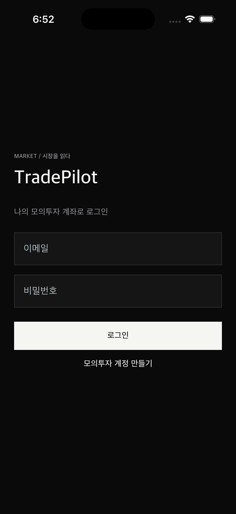 | 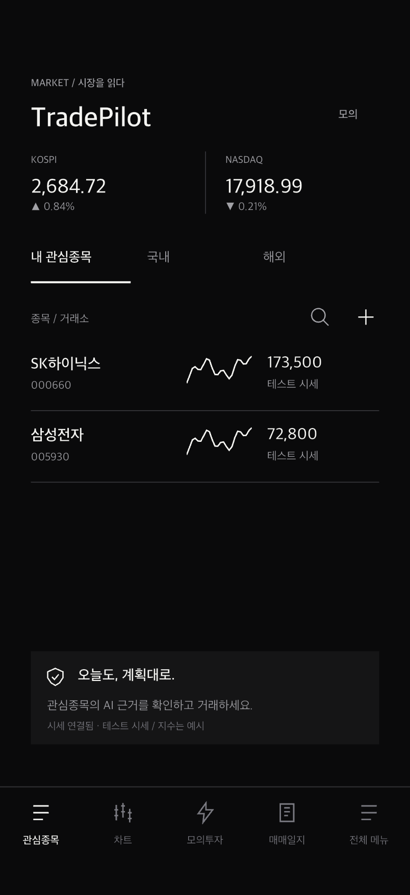 |
| 이메일·비밀번호 입력 및 모의 계정 생성 진입 | 서버에 등록된 관심종목과 테스트 시세 확인. 지수는 예시임을 화면에 표시 |

#### ② 종목 분석 상태와 행동 경고

| 차트·AI 상태 | 급등 추격 매수 경고 |
|---|---|
| 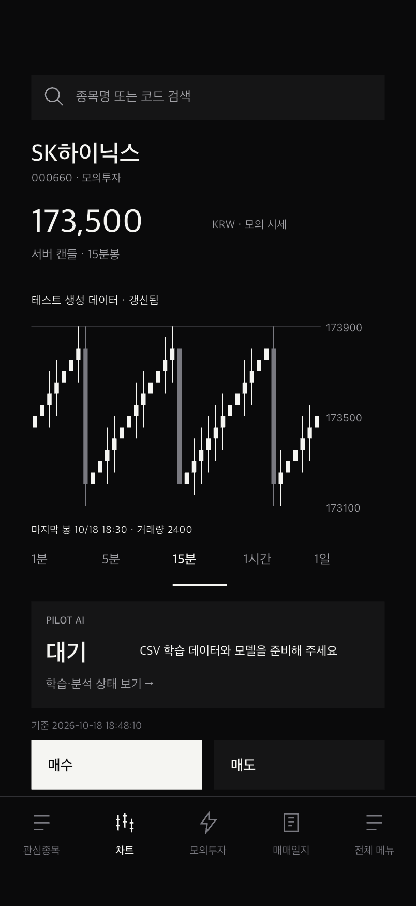 | 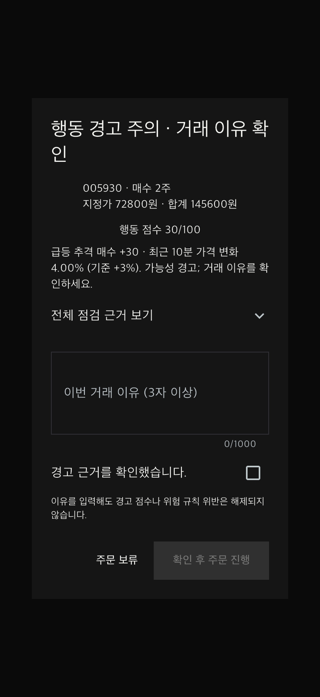 |
| 캔들·거래량·기준 시각과 모델 학습 대기 사유 표시 | 합성 시나리오에서 10분간 70,000원→72,800원(+4%)을 서버가 계산하여 FOMO +30점 표시. 이유·확인 미입력 시 진행 버튼 비활성화 |

#### ③ 모의주문 확인과 체결

| 주문 확인 | 모의 체결 내역 |
|---|---|
| 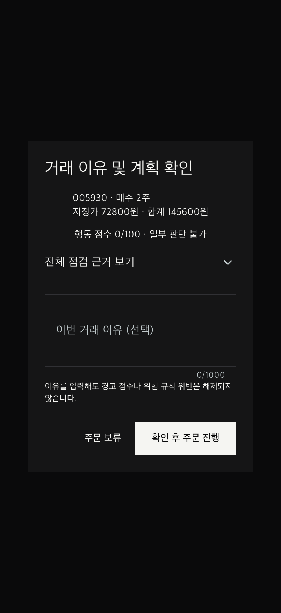 | 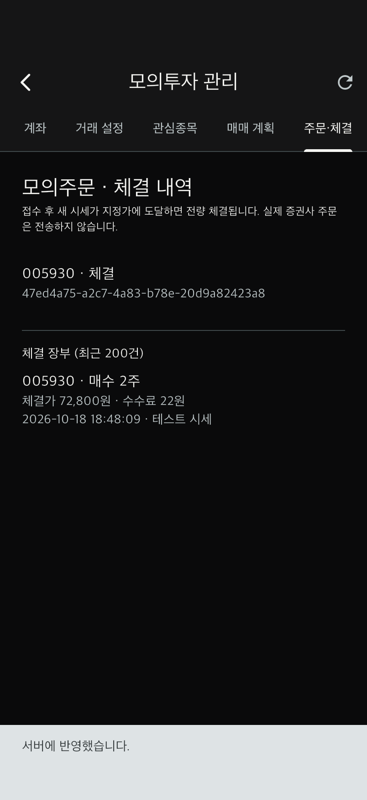 |
| 종목·방향·수량·가격·금액 및 점검 결과 확인. 낮음 상태에서 이유는 선택 입력 | 삼성전자 2주, 체결가 72,800원, 수수료 22원. 접수 결과와 체결 장부 구분 |

#### ④ 계좌와 위험 설정

| 모의 계좌 | 거래 원칙·위험한도 |
|---|---|
| 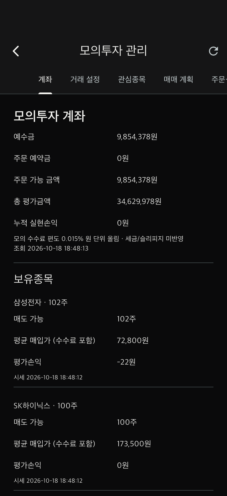 | 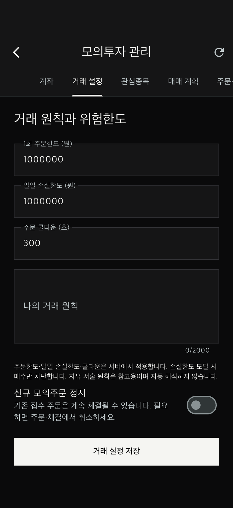 |
| 예수금·예약금·주문 가능 금액·보유 수량·평가손익 조회 | 주문한도·일일 손실한도·쿨다운·거래 원칙·신규 주문 정지 설정 |

#### ⑤ 매매일지와 복기

| 일지 요약 | 상세 분석·복기 |
|---|---|
| 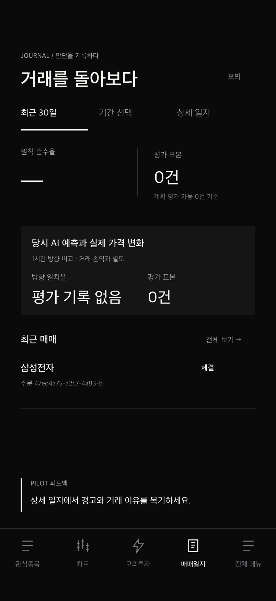 | 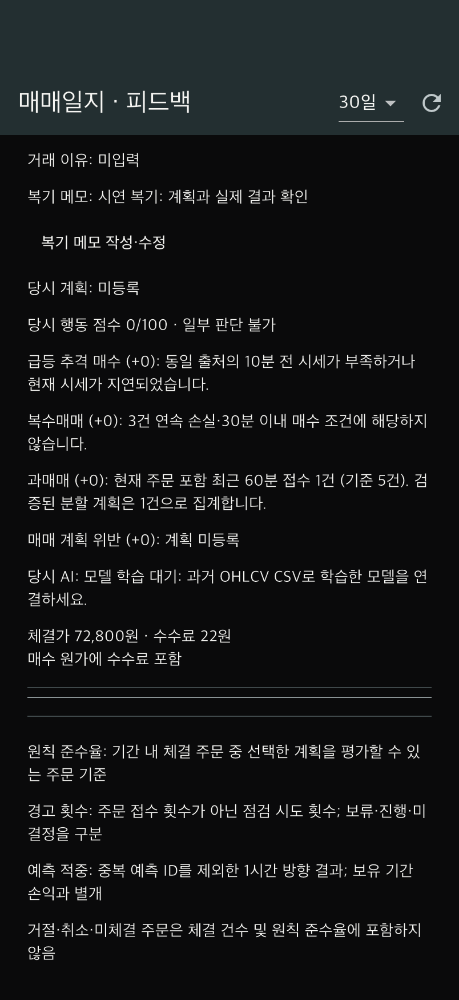 |
| 최근 거래와 평가 표본 표시. 평가 기록이 없으면 ‘평가 기록 없음’으로 안내 | 당시 행동 점검·계획·AI 상태·체결 수수료 및 사후 복기 메모 조회 |

#### ⑥ 추가 구현: 백테스트와 모의 자동매매

| 백테스트 결과 | 자동매매 실행 이력 |
|---|---|
| 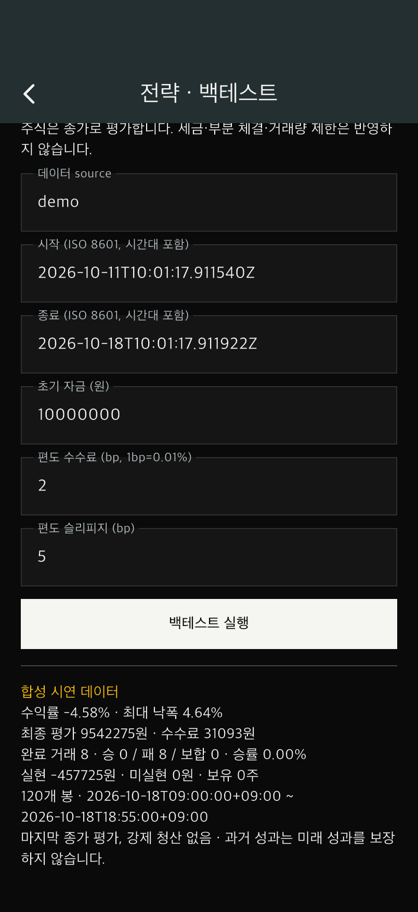 | 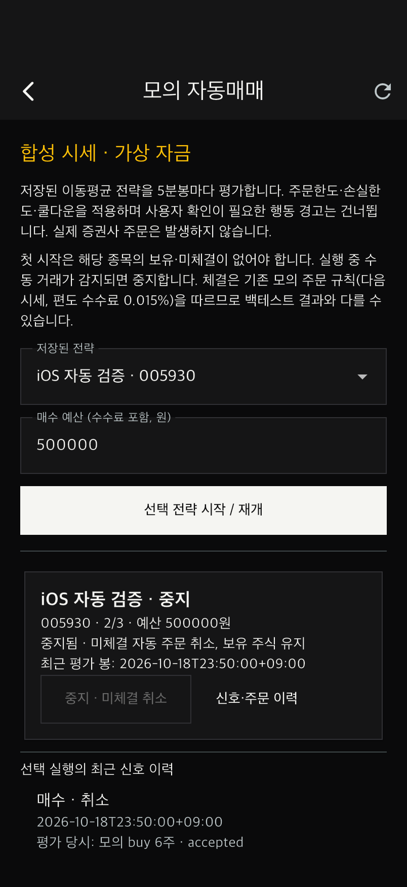 |
| 합성 데이터 표시, 수익률·최대 낙폭·완료 거래·수수료·미청산 보유량 | 실행 중지, 미체결 취소, 평가 봉과 신호·현재 주문 상태 확인 |

#### ⑦ 추가 구현: CSV 데이터 관리

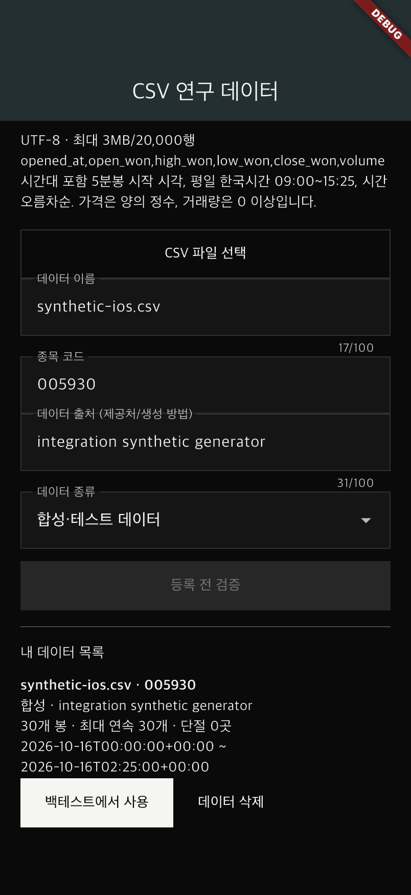

파일 선택·출처와 종류 입력·검증·저장 후 본인 데이터 목록에서 백테스트로 연결한다. 캡처에 나타난 30개 봉은 자동화 시험용 합성 파일이다. 파일 선택 결과를 시험 코드로 주입한 뒤 실제 API·DB에서 검증/저장/백테스트를 수행했으며, OS 파일 선택 창 자체의 자동 조작 검증과는 구분한다.

## 4. MVP 구성과 동작

### 4.1 구성 기술

| 영역 | 사용 기술 및 역할 |
|---|---|
| 모바일 앱 | Flutter·Dart: 화면, 입력, 화면 전환, API 및 실시간 시세 표시 |
| 서버 | Python·FastAPI: 인증, 시세·주문·행동 점검·일지·전략 API |
| 통신 | REST: 조회/저장/주문 요청, WebSocket: 시세 갱신 |
| 데이터베이스 | PostgreSQL·SQLAlchemy·Alembic: 계정, 계획, 주문, 체결, 분석, 전략, CSV 데이터 영속 저장 |
| 예측 준비 | CSV 기반 지표 생성·학습·시간순 검증·모델 파일·추론 인터페이스 |
| 검증 | pytest, Flutter 단위·위젯 테스트, iOS 통합 테스트 |

앱은 API로 서버와 통신하고, 서버가 위험 점검 및 주문 처리를 수행한 뒤 DB에 결과를 저장한다. 모의 체결 워커는 새 시세가 지정가 조건을 만족할 때 체결을 기록한다. 증권사 API는 나중에 연결할 수 있도록 인터페이스를 분리했으며 현재 실계좌 주문을 전송하지 않는다.

### 4.2 최소 동작 시나리오

| 순서 | 사용자 동작 | 확인할 MVP 결과 |
|---|---|---|
| 1 | 회원가입 후 로그인 | 개인 모의 계정 생성, 가상 현금 1,000만원으로 시작 |
| 2 | 관심종목에서 삼성전자 선택 | 종목·차트·테스트 시세·기준 시각 확인 |
| 3 | AI 상태 확인 | 모델 미준비 사유 표시, 검증되지 않은 확률을 제공하지 않음 |
| 4 | 매매 계획과 위험한도 설정 | 입력값 검증 후 DB 저장·재조회 |
| 5 | 1주·72,800원 모의 매수 입력 | 서버가 시세·잔액·한도·쿨다운·행동 규칙 점검 |
| 6 | 결과 확인 후 주문 확정 | 고유 주문 식별자로 접수, 조건 충족 시 다음 시세에서 모의 체결 |
| 7 | 계좌·주문/체결 내역 조회 | 수수료 포함 현금·보유량·주문 상태 갱신 |
| 8 | 매매일지에서 복기 작성 | 당시 점검 기록과 사후 메모를 별도로 저장·재조회 |

동일 종목·방향 주문을 기본 300초 이내 다시 요청하거나 주문한도를 초과하면 사유를 확인할 수 있다. 이미 처리한 주문을 같은 식별자로 재요청하는 경우에는 기존 결과를 반환한다.

추가 시연은 ‘백테스트’에서 전략 저장·결과 확인, ‘모의 자동매매 관리’에서 시작·중지, ‘CSV 등록 · 내 데이터 선택’에서 검증·저장·백테스트 연결 순으로 진행할 수 있다.

## 5. 검증 결과와 기능명세 완료 기준

아래 수치는 개발 과정에서 확인한 결과이며, 실제 금융시장이나 실제 투자자 대상의 성능을 의미하지 않는다.

| 검증 항목 | 확인 결과 | 해석 범위 |
|---|---|---|
| 최신 서버 전체 테스트 | **108개 통과** | 임시 PostgreSQL 기반 API·주문·위험 규칙·일지·전략·자동매매·CSV 검증 |
| 최신 Flutter 테스트 | **37개 통과** | 화면·입력·상태·데이터 선택·주문 확인 등 |
| 정적 분석 | Flutter analyze 및 Ruff 통과 | 개발 코드 검사 |
| 핵심 모의주문 시나리오 | **120건**: 체결80·취소20·거절20, 기대 상태 일치, 중복 체결0 | 기능명세의 100건 이상 시험 기준에 대응하는 결정론적 시험 |
| 행동 규칙 시나리오 | **16개**, 네 유형의 정상·위험·경계·계획 예외 검증 | 소규모 작성 시나리오 기준. 실제 감정 판별 정확도가 아님 |
| 로컬 시세 화면 반영 | 기존 핵심 검증에서 10개 이벤트 평균213.6ms·최대549ms | 합성 시세의 서버 시각→다음 앱 프레임. 거래소 지연·AI 추론 시간은 미측정 |
| iOS | iPhone17 네이티브 빌드 및 서버 연동 통합 테스트 통과 | 핵심 흐름, 백테스트, 자동매매, CSV 검증. 이번 제출용 관심종목·30점 경고도 추가 확인 |
| Android | ARM64 디버그 APK 빌드 성공 | 기기 실행·동일 UI/UX 실사용 검증은 별도 |
| AI 실제 예측 성능 | **미평가** | 실제 학습/시험 데이터와 모델 필요 |
| 사용자 만족도 | **미평가** | 기능명세의 10명 이상·평균4.0/5.0 기준은 후속 사용자 시험 필요 |

핵심 시나리오 집계 파일에는 당시 서버 테스트 수 77개가 기록되어 있다. 해당 파일은 v3 핵심 검증 시점의 증거이며, 이후 백테스트·자동매매·CSV 테스트를 추가한 최신 전체 수는 108개이다. 과거 증거 파일의 숫자를 최신 수치로 덮어쓰지 않았다.

## 6. 현재 한계 및 후속 개발

| 항목 | 현재 상태 | 후속 작업 |
|---|---|---|
| 실제 시세 | 합성 시세로 기능 시험 | 증권사/데이터 공급자 API 연결 및 오류 처리 검증 |
| AI 예측 | 학습·검증 구조와 UI/API 구현, 실제 모델 없음 | 실제 CSV 확보, 시간순 학습·검증·시험, 기준모델 비교, 모델 등록 및 최신 봉 공급 |
| 행동 점검 | 규칙 기반 시나리오 검증 | 실제 사용자 데이터로 오탐·수용성 확인 |
| UI/UX 실사용 | 주요 화면·상태 구현, iPhone 통합 검증 | 실제 사용자10명 이상 사용성·만족도 조사, Android 기기 검증 |
| 배포 | 로컬 시연 환경 | 외부 테스트 환경, HTTPS·운영 설정·배포 검증 |
| 실계좌 거래 | 미연결 | 후속 확장 범위. 현재 MVP는 모의투자 전용 |

**현재 제출의 성과는 디자인을 반영한 모바일 화면과 실제 서버·DB를 연결하여 거래 전 점검부터 모의 체결·복기까지 동작하는 MVP를 구성한 것이다. AI 실데이터 성능과 사용자 사용성 평가는 후속 검증 항목으로 남아 있다.**

추가로 현재 AI 로 개발 중에 있고 디테일 수정이 필요하여 아직은 많이 미흡한 부분이 있다. 추후 계속 디테일 보완 및 수정 진행 계획이 있다.
